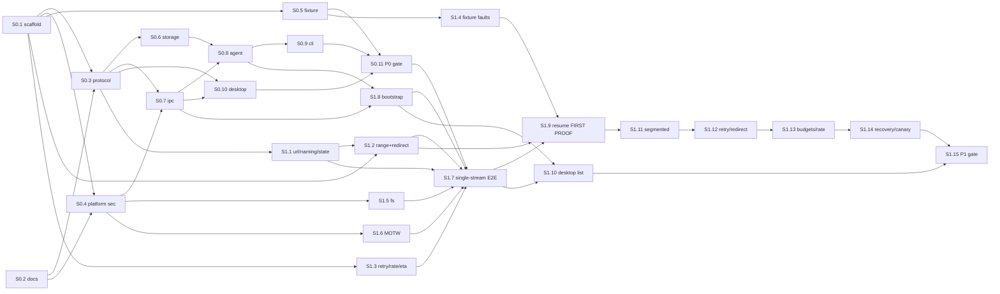

Status: ACCEPTED at GATE 1 (2026-11-15). Implementation is in progress; docs/IMPLEMENTATION_STATUS.md records what is actually built and tested.

# ForgeDM Phase 0 and Phase 1 Plan (ECC orch-build-mvp GATE 1 task_list)

| Field | Value |
|---|---|
| Date | 2026-11-15 |
| Repo root = Cargo workspace root | `C:\Users\karti\Desktop\IDM Clone` |
| Scope | Master spec section 13 Phase 0-1, section 14, engine parts of section 12. Execution prompt sections 1, 3, 4, 6, 7. Phase 2+ only as interface constraints (section 9). |
| Companion docs | `docs/ARCHITECTURE.md` (design, ADRs, versions), `docs/THREAT_MODEL.md` (threats, invariants), `docs/ECC_WORKFLOW.md` |
| Canonical contract | **Appendix A of this file.** All crate, state, action, error-code, exit-code, constant and test names in the three docs follow it. A change to Appendix A is a serialized protocol-change request. |
| Inputs | Both spec files, `docs/ECC_WORKFLOW.md`, four research reports (2026-11-15), architect / threat-model / planner drafts, critic review (verdict: ready-with-fixes; all must_fix items integrated, see section 11). |

No implementation code is written before GATE 1 approval.

---

## 0. Conventions

**Slice fields:** goal, owns (paths), depends_on, tests first (RED), evidence, security trigger + reviewers, size + risks.

**Ownership rules**
1. **One owner per path while in flight.** Parallel slices run in the main checkout, not in git worktrees (deviation and rationale: `docs/ECC_WORKFLOW.md` section 5). Each slice is limited to its pre-declared paths and uses its own `CARGO_TARGET_DIR` under `target\` (convention in `docs/DEVELOPMENT.md`). The coordinator commits in dependency order after GATE 2. Sequential ownership of the same path by non-overlapping slices is allowed and is listed explicitly.
2. **Lock-affecting files belong to the coordinator:** root `Cargo.toml`, `Cargo.lock`, `.cargo/config.toml`, `clippy.toml`. S0.1 declares every Phase 0/1 Rust dependency; afterwards only S0.10 (Tauri) changes the lockfile. Every cargo command uses `--locked`. A slice needing a new dependency stops and files a request (version, licence, MSRV); the coordinator handles requests one at a time. A slice may add `[[bin]]`/features to its own crate manifest, never dependencies.
3. **Module files for parallel waves are pre-declared in S0.1** (empty files with a `//!` comment). Serial critical-path slices own their crate's `lib.rs` while active.
4. **Tracking docs belong to the coordinator:** `IMPLEMENTATION_STATUS.md`, `TEST_EVIDENCE.md`, `NEXT_STEPS.md`, `SECURITY_REVIEW.md`, `CLAUDE.md`. S0.1 (coordinator) creates their skeletons. Slices report evidence in their handoff.
5. **At most 4 concurrent implementers** (parallel reqwest/sqlx/tauri builds, Defender scanning).

**Per-slice flow:** RED tests with recorded failing output -> GREEN -> refactor -> crate-scoped `cargo fmt`, `clippy -D warnings`, `test --locked` -> fresh-context reviewers -> fix every Critical/High with a regression test -> handoff with evidence -> commit at GATE 2 (conventional commit) -> coordinator runs `cargo test --workspace --locked` -> next serial slice starts only after review fixes are in the main checkout and the coordinator's `cargo test --workspace --locked` passes (no commit is needed before GATE 2).

**Reviewers**

| When | Reviewer |
|---|---|
| Every slice | `ecc:code-reviewer` |
| Rust slices | `ecc:rust-reviewer` (unsafe audit where marked) |
| Security-trigger slices | `ecc:security-reviewer` (blocking on Critical/High) |
| Slices marked [SFH] | `ecc:silent-failure-hunter` |
| Desktop slices | `ecc:typescript-reviewer`, `ecc:react-reviewer` |
| Phase gates | `ecc:pr-test-analyzer` + full `ecc:security-reviewer` pass over the phase diff |

**Precondition:** `rustc --version` works. At inspection rustup had no default toolchain (D2).

---

## 1. GATE 1 decisions

| ID | Decision | Recommendation | If declined |
|---|---|---|---|
| D1 | aws-lc-sys (reqwest default rustls provider) needs NASM on MSVC | `.cargo/config.toml` `[env] AWS_LC_SYS_PREBUILT_NASM = "1"`: uses NASM objects shipped inside aws-lc-sys (pinned by Cargo.lock checksum); nothing installed. Supply-chain trade-off recorded in THREAT_MODEL SUP-01. | Install NASM (approval); or reqwest `native-tls` (SChannel), decided by S0.1 build evidence |
| D2 | Toolchain | `rustup default stable` precondition; `rust-toolchain.toml` channel `1.100.0` + rustfmt + clippy; `rust-version = "1.94"` (sqlx 0.9 MSRV). Verified 2026-11-15: installed stable is rustc 1.100.0 (rustup default set; clippy 0.1.100, rustfmt 1.11.0; MSVC link verified with a scratch build). rustup treats a `1.100.0` pin as a separate toolchain from `stable`, so the coordinator installs it once with `rustup toolchain install 1.100.0 --profile minimal -c rustfmt -c clippy -c llvm-tools-preview` (approved at GATE 1). | `channel = "stable"`, exact version recorded in TEST_EVIDENCE |
| D3 | Node | Install Node 26.13.1 LTS (25.5.0 EOL since 2026-06-01; vitest 5.1.0 and jsdom 31.0.1 exclude it). `engines.node = "^24.15.0 \|\| ^26.0.0"` | Keep 25.5.0; pin vitest + @vitest/coverage-v8 4.1.12 and jsdom 29.1.1 |
| D4 | Quality tooling | `rustup component add llvm-tools-preview`; `cargo install --locked cargo-llvm-cov cargo-deny` (cargo-audit optional) | Coverage and advisory/licence gates recorded NOT RUN; `pnpm audit` still runs |
| D5 | Dependency downloads | Allow `cargo fetch`/builds and `pnpm install` with `minimumReleaseAge: 1440`, `strictDepBuilds: true`, `engineStrict: true`, empty `onlyBuiltDependencies`, committed lockfiles, `packageManager: "pnpm@10.29.2"` (installed version; avoids auto-download) | Nothing can be built |
| D6 | App identity (permanent: fixes the WebView2 data directory) | productName `ForgeDM`, identifier `dev.forgedm.desktop`, `useHttpsScheme: false` | Supply your own reverse-DNS identifier before S0.10 |
| D7 | ECC rust rules pack | Optional project-local install, dry-run first | Skip; rely on reviewer agents |
| D8 | MOTW HostUrl/ReferrerUrl | Sanitized `scheme://host[:port]/path` (no userinfo, query, fragment) | Full URL (not advised: IAE persists signed tokens and fragments, verified) |
| D9 | Test-only TLS fixture | dev-dep `rcgen` 0.14.10 (tokio-rustls 0.26.6 is already transitive via reqwest `rustls`) for `tls_untrusted_cert_fatal` | Skip; `tls_handshake_failure_fatal_not_retried` (https URL against the plaintext fixture) still runs |

### GATE 1 record (2026-11-15)

The user approved GATE 1 on 2026-11-15 and accepted every recommendation above:

| ID | Outcome |
|---|---|
| D1 | Accepted. `AWS_LC_SYS_PREBUILT_NASM = "1"`; no NASM install. |
| D2 | Accepted. `rust-toolchain.toml` pins `1.100.0` (already installed as a separate rustup toolchain). |
| D3 | Accepted. Node 26.13.1 LTS (being installed separately). |
| D4 | Accepted. `llvm-tools-preview`, `cargo-llvm-cov` and `cargo-deny` installed or being installed. **`cargo-audit` is NOT installed**; cargo-deny advisories replace it. |
| D5 | Accepted. `cargo fetch` and builds allowed. Once `Cargo.lock` exists, every cargo command uses `--locked`. |
| D6 | Accepted. Identifier `dev.forgedm.desktop`. |
| D7 | **Declined by the coordinator.** The supported ECC installer, run as a dry run for `rust`, planned 936 operations: every language's rules, a second copy of the common rules, agents, commands and hooks. That would duplicate the ECC install, which the execution prompt forbids. Rust guidance comes from `ecc:rust-reviewer` and the `rust-patterns` / `rust-testing` skills (`docs/ECC_WORKFLOW.md` section 4). |
| D8 | Accepted. MOTW records a sanitized URL (`scheme://host[:port]/path`). |
| D9 | Accepted. `rcgen` 0.14.10 as a test-only dev-dependency. |

---

## 2. Conflicts resolved and deviations to ratify

| # | Conflict | Resolution | Ratify as spec deviation |
|---|---|---|---|
| C1 | Spec lower-case doc names vs execution prompt upper-case | Upper-case. `security.md` -> `THREAT_MODEL.md` + `SECURITY_REVIEW.md`; `development.md` -> `DEVELOPMENT.md` | yes |
| C2 | Probe: spec section 4.1 (HEAD, then `bytes=0-0` if HEAD fails, verify a real 206) vs research (`GET bytes=0-`, no HEAD) vs threat draft | HEAD (5 s) as a hint only, failures tolerated; **always** `GET Range: bytes=0-0` with `Accept-Encoding: identity`; GET wins on conflict; a 200 is dropped unread. Reusing the probe stream is deferred to Phase 5 (ADR-009). | yes (interpretation) |
| C3 | Spec wants HTTP/2 where compatible; h2 multiplexes N segments onto one TCP connection | Transfers use `http1_only()`; reqwest `http2` feature omitted (ADR-007). Benchmark in Phase 5. | yes |
| C4 | Spec: pipe DACL allows current user and SYSTEM | `D:P(D;;GA;;;NU)(A;;GA;;;<user-sid>)S:(ML;;NWNR;;;ME)`: user only, NETWORK deny first, medium label. Stricter. | yes |
| C5 | windows-sys vs `windows` for FFI | `windows = "=0.62.2"` (COM needed for IAttachmentExecute; tauri 2.12.5 uses ^0.62). Never add windows-core or windows-sys directly. | no |
| C6 | Tauri MSRV 1.90 vs sqlx 1.94 | `rust-version = "1.94"` | no |
| C7 | Layout | Add `forgedm-ipc` (transport shared by agent, CLI, desktop, future native host). No `tests/integration` crate: `CARGO_BIN_EXE_*` exists only in the owning package, so process tests live in agent/CLI `tests/`; fixture stays at `tests/fixtures`; proofs in `scripts/`. | yes |
| C8 | Spec section 5 lists more tables | Migration 0001: `downloads`, `segments`, `download_events`, `settings`. Queues, schedules, categories, host policies, external tools are later additive migrations. Validators live on `downloads`; segment state is derived. | yes |
| C9 | States: spec names Interrupted/Queued, no finalize state; drafts disagreed | 14 states (Appendix A.6). `interrupted` is persisted and set only by shutdown/startup reconcile; auto-resume moves it to `queued`. `finalizing` is a persisted state (rename and MOTW are crash-reconciled from it). No `finalize_stage` column. | yes |
| C10 | Writer via spawn_blocking vs thread | Dedicated `std::thread` per active download (spawn_blocking tasks cannot be aborted) | no |
| C11 | Encryption at rest: fixed-entropy DPAPI vs row/column-entropy DPAPI vs AES-GCM envelope | Per-value DPAPI (CurrentUser) with entropy `"ForgeDM/v1/<column>/<download_id>"`; no new dependency; redacted `url_display` in plaintext (ADR-012) | no (spec allows DPAPI) |
| C12 | governor | Rejected (ignores tokio paused time; immutable quota). Custom tokio token bucket (ADR-013). | no |
| C13 | Spec runs `pnpm tauri build` | Phase 0/1 run `tauri build --debug --no-bundle`; NSIS is Phase 2 | yes |
| C14 | TypeScript latest is 7.0.2 | Pin `~6.0.3` (typescript-eslint 8.72.2 peer `<6.1.0`) | no |
| C15 | Spec allows JSON or MessagePack | JSON only (ADR-004) | yes |
| C16 | Spec section 4.1 configurable overall timeout | None for bodies (would kill large downloads); connect 15 s + per-read 30 s | yes (Deferred) |
| C17 | Non-identity Content-Encoding on a 200 (architect stored raw bytes) | Rejected: `failed(unsupported_content_encoding)` (Inv-07). Always rejected on 206. | yes |
| C18 | Spec section 4.2 collision ask/overwrite/skip | Phase 1: `rename` (default, `name (N).ext`) and `fail` (tests). A completed file is never overwritten. | yes (Partial) |
| C19 | Spec section 3 coalesced ~4/s events to UI | Agent emits coalesced 4 Hz events (CLI `--watch` uses them); Phase 1 desktop polls `GetSnapshot` at 1 Hz; desktop subscription is Phase 2 | yes (Partial) |
| C20 | Spec section 4.1 custom headers, referrer, explicit credentials | Deferred. `needs_credentials` state exists; 401/407 lands there; no Referer is sent. | yes (Deferred) |
| C21 | Spec section 4.3 per-host bandwidth cap and fairness | Per-host connection cap only; per-host bandwidth cap deferred; fairness is approximate (per-download bucket then global bucket per chunk) | yes (Partial) |
| C22 | Node 25.5.0 EOL | D3 | no |
| C23 | Segment locking: per-segment mutex (research) vs one table mutex (architect) | One `std::sync::Mutex<SegmentTable>` per download, never held across `.await` (atomic checkpoint snapshots and splits) (ADR-010) | no |
| C24 | Crate graph: drafts disagreed | `core` and `storage` do not depend on each other; shared value enums (state, error codes, priority) defined once in `protocol`; agent adapts storage to core's `DownloadStore` port (ADR-003) | no |
| C25 | Private-destination policy: threat draft claimed DNS-resolved classification + IP pinning | Phase 1 classifies the parsed `url::Host` (all IP literal forms, `localhost`, `*.localhost`) on the initial URL and every redirect hop. DNS-name classification + pinned resolver is Phase 3 (required before the browser extension). | no |
| C26 | Client checks of server image path: name-only warning vs full path vs abort | Expected agent path is an explicit client API parameter (production: canonical sibling `forgedm-agent.exe`; tests: `CARGO_BIN_EXE_forgedm-agent`); full canonical path compared case-insensitively; fail closed. No env-var override. | no |
| C27 | Data directory layout and identifier differed | `%LOCALAPPDATA%\ForgeDM\{forgedm.db, logs\, run\}` (flat); identifier per D6 | no |
| C28 | Approved download roots (threat draft P01) | Phase 1 validates `target_dir` (absolute, existing directory, local fixed/removable volume, not a device path) and confines created files with `ensure_within`. An approved-roots list is Phase 3 (before external sources can propose paths). | no |

---

## 3. Layout and dependency set

```
Cargo.toml Cargo.lock rust-toolchain.toml clippy.toml .cargo/config.toml .gitattributes .gitignore CLAUDE.md
package.json pnpm-workspace.yaml pnpm-lock.yaml                (S0.10)
crates/forgedm-protocol   wire types, shared value enums, pure frame codec (no I/O, no tokio)
crates/forgedm-platform   ALL unsafe FFI (SID, pipe, peer, lock, known folders, DPAPI, fs, MOTW)
crates/forgedm-core       domain + engine (url policy, naming, state machine, http semantics, retry, rate limit,
                          progress, client, writer, transfer, engine); ports DownloadStore, Clock, Sleeper
crates/forgedm-storage    sqlx SQLite, migrations, repositories, SecretSealer port
crates/forgedm-ipc        pipe server/client, identity checks, subscriptions, bootstrap
crates/forgedm-agent      lib + bin forgedm-agent
crates/forgedm-cli        bin forgedm
tests/fixtures            package forgedm-fixture (lib + bin forgedm-fixture), publish = false
apps/desktop              Vite/React/TS; src-tauri = package forgedm-desktop (workspace member)
scripts/                  check-env.ps1 check.ps1 windows-smoke.ps1 phase1-proof.ps1
docs/                     ARCHITECTURE THREAT_MODEL PHASE_0_1_PLAN DEVELOPMENT ECC_WORKFLOW + tracking docs
```

**Internal dependency edges (checked by `check.ps1 :: layering`):** protocol -> none; platform -> none; core -> protocol, platform; storage -> protocol; ipc -> protocol, platform; agent -> core, storage, ipc, protocol, platform; cli -> ipc, protocol; desktop -> ipc, protocol; fixture -> none, dev-dependency only (core, agent, cli).

**Dependency set:** exactly the crates, versions and features in ARCHITECTURE section 1.5 (research-verified 2026-11-15). Never add: rusqlite (`links = "sqlite3"` conflict), governor, windows-core, windows-sys (direct), rand, time, chrono, interprocess, retry crates, ts-rs (deferred). Timestamps are unix ms; jitter uses splitmix64 seeded from `std::hash::RandomState`.

**Profiles:** dev dependencies `opt-level = 2` (sha2 at 3); release thin LTO, `codegen-units = 1`, `panic = "unwind"` (never `abort`: agent keeps task-panic isolation), `overflow-checks = true`.

---

## 4. Phase 0 slices

### S0.1 Workspace scaffold, toolchain pin, dependency lock (coordinator)
- **Goal:** `cargo build --workspace --locked` compiles every crate skeleton plus the full dependency set including the TLS stack, with lints enforced, from the space-containing repo path.
- **Owns:** root files (section 3), `crates/*/{Cargo.toml,src/lib.rs}` (+ `src/main.rs` stubs for bins), `tests/fixtures/{Cargo.toml,src/lib.rs}`, tracking-doc skeletons (`IMPLEMENTATION_STATUS`, `TEST_EVIDENCE`, `NEXT_STEPS`, `SECURITY_REVIEW`), `crates/forgedm-core/tests/tls_smoke.rs`, and pre-declared empty modules:
  - core: `url_policy`, `state`, `naming/{mod,content_disposition,sanitize}`, `http/{mod,content_range,validators,range_decision,probe_classify,redirect}`, `clock`, `retry`, `rate_limit`, `progress`
  - platform: `error`, `wide`, `sid`, `pipe`, `peer`, `instance_lock`, `known_folders`, `dpapi`, `fs`, `motw`
- **Config:**
  - Workspace: resolver 3, edition 2024, `rust-version = "1.94"`.
  - Lints (ARCHITECTURE section 1.4): `unsafe_code = "deny"`, `unsafe_op_in_unsafe_fn = "deny"`; clippy `unwrap_used`, `expect_used`, `panic`, `todo`, `unimplemented`, `dbg_macro`, `print_stdout`, `print_stderr`, `await_holding_lock`, `undocumented_unsafe_blocks`, `cast_possible_truncation`, `cast_sign_loss`, `cast_possible_wrap` (errors under `-D warnings`).
  - `clippy.toml`: `allow-unwrap-in-tests`, `allow-expect-in-tests`; `disallowed-methods` for `reqwest::ClientBuilder::{danger_accept_invalid_certs, danger_accept_invalid_hostnames, tls_danger_accept_invalid_certs, tls_danger_accept_invalid_hostnames, add_root_certificate, tls_certs_merge, tls_certs_only, tls_backend_preconfigured, use_preconfigured_tls, tls_sslkeylogfile, tls_early_data, timeout}`, `reqwest::RequestBuilder::timeout`, `reqwest::Client::new`, `std::fs::rename`, `tokio::fs::rename`, `std::fs::OpenOptions::append`. Each path is confirmed to resolve under the chosen features, or marked `allow-invalid = true` with a comment (an unresolvable path is otherwise a clippy error).
  - `.gitattributes`: `*.sql text eol=lf`, `*.json text eol=lf`. `.gitignore`: `target/`, `node_modules/`, `dist/`, `gen/`, `*.forgedm.part`.
  - `.cargo/config.toml` per D1.
- **Depends on:** precondition, D1, D2, D5.
- **Tests first:** `client_builds_with_configured_tls_provider` (builder with `http1_only`, all `no_*` decompression flags, `tls_backend_rustls` returns `Ok`).
- **Evidence:** `rustc --version` = 1.100.0; `cargo metadata --locked --no-deps` lists 8 packages; `cargo build --workspace --locked` exits 0 with aws-lc-sys built (from the spaced path; if a build script fails on the space, record it and use a `CARGO_TARGET_DIR` without spaces); `cargo test -p forgedm-core --test tls_smoke --locked` passes 1; `fmt --check` and `clippy --workspace --all-targets --locked -- -D warnings` exit 0.
- **Security:** yes (supply chain). Reviewers: rust, security, code (rust because S0.1 owns `tls_smoke.rs` and the workspace lint configuration; THREAT_MODEL section 7).
- **Size/risks:** M. aws-lc build, first fetch of a few hundred crates, toolchain download, spaced path.

### S0.2 Architecture, threat model, development docs
- **Owns:** `docs/{ARCHITECTURE,THREAT_MODEL,PHASE_0_1_PLAN,DEVELOPMENT}.md`.
- **Work:** apply GATE 1 decisions, flip status to Accepted, write `DEVELOPMENT.md` (build, test, scripts, ECC hooks: no `tauri dev`), architect + security-reviewer sign-off with every THREAT_MODEL control mapped to a slice test or marked PL/residual.
- **Depends on:** GATE 1 (runs parallel with S0.1).
- **Size:** S.

### S0.3 Protocol v1
- **Goal:** Appendix A as exhaustive Rust types with a bounded pure codec; golden JSON shared with the desktop TS tests.
- **Owns:** `crates/forgedm-protocol/**` including `tests/golden/v1/*.json`.
- **Design:** exactly Appendix A. Two-step parse (`RawEnvelope` with `deny_unknown_fields`, then typed payload with `deny_unknown_fields`; no `flatten`). `FrameDecoder` is incremental over byte chunks; it rejects the length before buffering a body. `validate()` enforces Appendix A.3 limits.
- **Depends on:** S0.1, S0.2.
- **Tests first:** `frame_roundtrip_min_and_max`, `oversized_length_rejected_before_reading_body` (decoder errors after only the 4-byte header is fed), `zero_length_rejected`, `truncated_header_and_body_unexpected_eof`, `invalid_utf8_or_json_is_malformed_frame_not_panic`, `unknown_action_and_unknown_field_rejected`, `golden_files_roundtrip_value_equal`, `version_negotiation_accepts_1_rejects_0_and_2`, `validate_rejects_each_limit`, `state_and_error_code_strings_stable`, `proptest_request_roundtrip`, `proptest_decoder_never_panics_on_arbitrary_chunks`.
- **Evidence:** `cargo test -p forgedm-protocol --locked` 0 failed; clippy clean.
- **Security:** yes (IPC parsing). Reviewers: rust, security, code.
- **Size/risks:** M. serde tagging with `deny_unknown_fields`.

### S0.4 Platform security primitives
- **Owns:** `crates/forgedm-platform/src/{error,wide,sid,pipe,peer,instance_lock,known_folders,dpapi}.rs`, `tests/{security,folders,dpapi}.rs`.
- **Design:**
  - `error.rs` defines **every** Phase 1 `PlatformError` variant (incl. fs and MOTW ones used by S1.5/S1.6); `wide.rs` provides UTF-16 conversion (NUL rejected) and the verbatim `\\?\` path builder used by S1.5/S1.6.
  - FFI modules: `#![allow(unsafe_code)]`, `// SAFETY:` on every block, `windows::core::Owned` RAII.
  - SID strings validated against `^S-1-\d+(-\d+)+$` before entering SDDL (no SDDL injection). Security descriptor kept alive for the server lifetime.
  - `create_pipe_instance(name, first: bool)` wraps tokio `ServerOptions` with `reject_remote_clients(true)`, `first_pipe_instance(first)`, `pipe_mode(Byte)`, `max_instances(PIPE_MAX_INSTANCES = 17)`, 64 KiB buffers, `create_with_security_attributes_raw`. `PermissionDenied` maps to `PipeError::NameInUse`.
  - `peer_identity(pid) -> {sid, image_path}` fails closed (OpenProcess limited rights, token user, `QueryFullProcessImageNameW`); SID equality via `EqualSid(..).is_ok()` (an `Err` means "not equal").
  - Known folders: `SHGetKnownFolderPath` + `CoTaskMemFree`. Lock: `File::try_lock`. DPAPI: `CryptProtectData`/`CryptUnprotectData` with `CRYPTPROTECT_UI_FORBIDDEN`, caller-supplied entropy, no prompt struct, `LocalFree`, plaintext zeroed.
- **Depends on:** S0.1, S0.2.
- **Tests first:** `current_user_sid_matches_whoami_csv`, `sid_validation_rejects_sddl_injection`, `pipe_dacl_readback_from_live_handle_is_deny_nu_allow_user_me_label_only` (deny ACE first; exact match of the readback; no WD, AN, SY, BA, AC `S-1-15-2-1`, RC `S-1-15-3-*` or package SIDs), `second_first_instance_is_name_in_use`, `peer_identity_of_self_matches_user_and_exe`, `peer_check_rejects_unexpected_image`, `peer_check_fails_closed_for_pid_4`, `known_folders_downloads_and_localappdata_absolute_dirs`, `instance_lock_excludes_second_and_releases_on_drop`, `dpapi_roundtrip_and_ciphertext_hides_plaintext`, `dpapi_tampered_blob_fails`, `dpapi_wrong_entropy_fails`, `wide_rejects_interior_nul_and_builds_verbatim_paths`.
- **Evidence:** `cargo test -p forgedm-platform --locked`.
- **Security:** yes (unsafe FFI, IPC ACL, secrets). Reviewers: rust (unsafe audit), security, code.
- **Size/risks:** L. `EqualSid` Err semantics; handle/descriptor lifetimes.

### S0.5 Fixture server baseline
- **Goal:** in-process and standalone loopback server; deterministic content at any offset (incl. > 4 GiB); correct single-range semantics; request log.
- **Owns:** `tests/fixtures/**`.
- **Routes:** `GET|HEAD /f/{seed}/{size}` with flags `head=0` (HEAD -> 405), `cl=0` (chunked), `ranges=0`, `slow=<Bps>`, `etag=strong|weak|none`, `lm=<http-date>`, `cd=<pct-encoded raw header>`, `encoding=gzip` (header only), `drop_after=<N>`, `t=<test key>`.
- **API:** `FixtureServer::start() -> (base_url, RequestLog)`; `content::fill/sha256` (splitmix64 counter generator, O(1) per offset); `verify::file_matches(path, seed, size) -> Result<(), Mismatch{offset}>`. Binary `forgedm-fixture serve --port 0` (prints address) and `forgedm-fixture hash --seed S --size N`. Binds 127.0.0.1 only.
- **Depends on:** S0.1.
- **Tests first:** `generator_offset_addressable_incl_beyond_4gib`, `generator_detects_one_byte_shift`, `full_200_body_matches_sha`, `single_range_206_valid_content_range`, `open_ended_and_suffix_ranges`, `unsatisfiable_416_star_total`, `head_disabled_405`, `no_cl_is_chunked`, `drop_after_closes_mid_body`, `request_log_records_method_range_conn_id`, `binds_loopback_only`, `verify_reports_first_mismatch_offset`.
- **Evidence:** `cargo test -p forgedm-fixture --locked`.
- **Security:** no (test-only; loopback binding asserted). Reviewers: rust, code.
- **Size:** M.

### S0.6 Storage
- **Owns:** `crates/forgedm-storage/**` (src, `migrations/0001_init.sql`, `build.rs` with `rerun-if-changed=migrations`, tests).
- **Schema 0001:** ARCHITECTURE section 7.2 (STRICT tables; enum columns validated in Rust, not CHECK; `part_file_id`, `finalize_target`, sealed URL columns).
- **API:** `Storage::open(path, Arc<dyn SecretSealer>)`: `create_if_missing`, WAL, `synchronous=FULL`, foreign keys, `busy_timeout` 5 s, `journal_size_limit` 64 MiB, runtime check `sqlite_version() >= 3.37.0`, migrate. Writer pool 1 connection, every write via `begin_with("BEGIN IMMEDIATE")`; reader pool 4 with `query_only`. Repositories: downloads `insert/get/list(states, limit, offset)/transition(id, from, to, reason, event)` (compare-and-set `WHERE state = ?`); segments `replace_plan/save_checkpoint` (one transaction); events append with retention; settings get/put. `SecretSealer::seal/unseal(bytes, SealContext{column, download_id})`. Only `&'static str` SQL with binds; no `AssertSqlSafe`.
- **Depends on:** S0.3.
- **Tests first:** `migrations_apply_fresh_and_idempotent`, `pragmas_wal_full_fk_busy`, `sqlite_version_at_least_3_37`, `migration_files_have_no_crlf`, `download_roundtrip_with_test_sealer`, `sealed_columns_raw_db_and_wal_bytes_lack_canary`, `wrong_row_entropy_fails` (sealed value copied to another row/column fails to unseal), `unseal_failure_is_typed_crypto_error`, `unknown_state_string_rejected_on_load`, `segment_committed_outside_bounds_rejected`, `segments_cascade_on_delete`, `checkpoint_batch_is_atomic_on_mid_failure`, `transition_cas_conflict_on_stale_from_state`, `concurrent_immediate_writers_never_busy` (8 tasks x 100 transactions), `list_bounded_and_ordered`, `sql_metacharacters_inert`, `corrupt_db_typed_error_file_bytes_unchanged`, `event_retention_cap`.
- **Evidence:** `cargo test -p forgedm-storage --locked`.
- **Security:** yes (DB, secrets). Reviewers: rust, security, code.
- **Size:** M.

### S0.7 IPC transport [SFH]
- **Owns:** `crates/forgedm-ipc/src/{lib,error,server,client,identity,subscribe}.rs`, `tests/{transport,identity,subscribe}.rs`.
- **Server (ADR-005):**
  - Capacity invariant: `PIPE_MAX_INSTANCES = MAX_ACTIVE_CONNECTIONS + 1 = 17`. The accept loop acquires a `Semaphore(16)` permit **before** awaiting `connect()` on the listening instance, then creates the replacement listening instance **before** handing off or dropping any connected handle. The instance count never reaches 0 while serving. A create failure after startup is fatal (security event; server stops; agent exits 4); it is never retried without `first_pipe_instance(true)`.
  - Caller SID check (`GetNamedPipeClientProcessId` -> peer identity) before reading any frame; mismatch closes and logs a `forgedm::security` event.
  - Handshake within 5 s; frame body within 10 s of its header; idle timeout 60 s for connections without a subscription or request; one request processed at a time per connection.
  - Injected `RequestHandler` trait object; subscriptions use a per-connection bounded outbound queue (256 frames, events via `try_send`; overflow drops the subscription and sends `ResyncRequired{lagged}`).
- **Client:** tokio `ClientOptions` defaults (SQOS identification kept); `ERROR_PIPE_BUSY` retried every 50 ms for up to 5 s, then `IpcError::Busy`; `NotFound` -> `IpcError::NotRunning`; verifies the server **before the first write** (same SID, full canonical image path equals the explicit `expected_agent_path`, case-insensitive; fail closed); correlates by `request_id`; 10 s request timeout.
- **Depends on:** S0.3, S0.4.
- **Tests first:** `handshake_roundtrip`, `non_handshake_first_frame_closes`, `handshake_timeout_closes_connection`, `oversized_frame_closes_connection`, `garbage_client_then_next_client_served`, `partial_frame_times_out`, `idle_connection_closed_after_timeout`, `seventeenth_client_waits_then_served`, `pipe_name_never_vanishes_under_churn` (all clients connect/disconnect repeatedly while a probe thread calls `CreateNamedPipe` with FIRST_PIPE_INSTANCE on the same name and must always get ERROR_ACCESS_DENIED), `pipe_busy_retried_then_errors`, `absent_pipe_is_agent_not_running`, `wrong_server_image_rejected_and_server_receives_zero_frames`, `identity_decision_rejects_other_sid` (unit, injected identity), `low_integrity_client_denied` (helper exe copied to temp, `icacls <exe> /setintegritylevel low`; UNVERIFIED, recorded NOT RUN if setup fails), `version_mismatch_structured_error`, `concurrent_clients_get_own_responses` (16 clients x 50 requests), `squatted_name_server_start_fails_closed`, `subscribe_seq_ordered_and_resync_on_lag`, `pipelined_requests_answered_in_order_one_at_a_time` (pipelined requests on one connection are answered in order, one processed at a time), `client_request_times_out_after_10s` (paused time; CLIENT_REQUEST_TIMEOUT).
- **Evidence:** `cargo test -p forgedm-ipc --locked`.
- **Security:** yes. Reviewers: rust, security, code, SFH.
- **Size/risks:** L. Instance-count invariant; cross-user squat is manual only.

### S0.8 Agent skeleton
- **Goal:** `forgedm-agent.exe` serves Handshake, Ping, GetAgentStatus, GetSnapshot, Subscribe, Unsubscribe, ListDownloads, ShutdownAgentSafely. Every other action returns `not_implemented` (tracked in IMPLEMENTATION_STATUS).
- **Owns:** `crates/forgedm-agent/**`: `main.rs`, `lib.rs`, `error.rs` (`AgentError::to_wire()`, the only wire-code mapping), `config.rs`, `logging.rs`, `app.rs`, `sealer.rs` (DPAPI `SecretSealer`), `events_hub.rs` (StateHub), `handlers/{mod,lifecycle,query,enqueue,control,limits}.rs`, tests.
- **Flags:** `--data-dir <abs>`, `--proxy system|none` (default `system`), `--log-level <filter>` (default `info`). Exit codes: Appendix A.8.
- **Startup order:** parse args (2) -> resolve and validate data dir (6) -> take `run\agent.lock`, retrying up to 3 s (else 3) -> rolling file logs -> create first pipe instance with `first_pipe_instance(true)`, retrying `NameInUse` up to 3 s (else security event + 4); no accept loop yet -> open storage with DPAPI sealer, migrate (else 5) -> reconcile -> start StateHub and serve.
- **StateHub (ADR-019):** single actor owning the summary map, `seq`, a 1024-event ring buffer and subscribers. `Subscribe(after_seq)` registers and replays `(after_seq, current]` in one actor turn; evicted `after_seq` or a different `agent_instance_id` -> `resync_required`.
- **Shutdown:** stop accepting, drain, checkpoint, set `probing`/`downloading`/`verifying` downloads to `interrupted(agent_shutdown)`, set `pausing` downloads to `paused`, leave `finalizing` to reconcile (ARCHITECTURE 2.6), close DB, release lock, exit 0.
- **Depends on:** S0.4, S0.6, S0.7.
- **Tests first** (via `CARGO_BIN_EXE_forgedm-agent`): `starts_creates_db_and_pipe_and_handshakes`, `second_agent_same_data_dir_exits_3`, `shutdown_exits_0_releases_lock_restart_ok`, `restart_immediately_after_kill_succeeds`, `corrupt_db_exits_5_file_preserved`, `squatted_pipe_exits_4_and_logs_security_event`, `status_reports_pid_version_and_proxy_source`, `list_empty`, `unimplemented_actions_return_not_implemented`, `relative_data_dir_exits_2`, `logs_written_under_data_dir`, `no_event_lost_between_snapshot_and_subscribe` (continuous state changes while reconnecting; reconstructed client state equals a final GetSnapshot), `subscribe_after_evicted_seq_requires_resync`.
- **Evidence:** `cargo test -p forgedm-agent --locked`.
- **Security:** yes. Reviewers: rust, security, code.
- **Size:** M.

### S0.9 CLI skeleton
- **Owns:** `crates/forgedm-cli/**`: `main.rs`, `cli.rs`, `client.rs`, `output.rs`, `commands/{status,list,agent}.rs`, `tests/{cli_basic.rs,support/mod.rs}`.
- **Commands:** `forgedm status`, `forgedm list [--json]`, `forgedm agent stop`; global `--data-dir`. `status` never auto-starts the agent (it reports "not running"). Expected agent path = canonical sibling of `current_exe()`. Exit codes: Appendix A.8.
- **Test support:** locates `forgedm-agent.exe` next to `CARGO_BIN_EXE_forgedm`; fails (does not skip) with "run `cargo build --workspace --bins`" if missing.
- **Depends on:** S0.8.
- **Tests first:** `status_without_agent_exits_10_with_message`, `status_with_real_agent_prints_versions`, `list_empty_and_json_shape`, `unknown_subcommand_exits_2`, `agent_stop_shuts_agent_down`.
- **Evidence:** `cargo build --workspace --bins --locked` then `cargo test -p forgedm-cli --locked`.
- **Security:** yes (IPC client). Reviewers: rust, security, code.
- **Size:** S.

### S0.10 Desktop minimal shell
- **Goal:** a `--debug --no-bundle` build opens a window showing real agent status and the (empty) list via Tauri -> ipc -> agent, and "Background engine not running" when absent. Original name and icon.
- **Owns:** `apps/desktop/**`, root `package.json`, `pnpm-workspace.yaml`, `pnpm-lock.yaml`; root `Cargo.toml` members line + `Cargo.lock` (applied by the coordinator in the main checkout).
- **Stack:** ARCHITECTURE section 1.5 npm versions (Vite 8.3.8, React 19.3.1, TS ~6.0.3, Tailwind 4.3.5 via `@tailwindcss/vite`, vitest/jsdom per D3, @tauri-apps/cli and api 2.12.4); no Tauri plugins.
- **Security setup (ADR-022):** `build.rs` `try_build(Attributes::new().app_manifest(AppManifest::new().commands(&["agent_status","list_downloads"])))`; capability `main-window` grants only `allow-agent-status`, `allow-list-downloads`; `app.security.capabilities = ["main-window"]`; CSP `default-src 'self'; script-src 'self'; style-src 'self'; img-src 'self'; font-src 'self'; connect-src ipc: http://ipc.localhost; object-src 'none'; base-uri 'none'; form-action 'none'; frame-src 'none'; frame-ancestors 'none'`; `freezePrototype: true`; `withGlobalTauri: false`; identity per D6; `bundle.targets: ["nsis"]` (not built); `index.html` without inline script/style; Vite `assetsInlineLimit: 0`. Check Tauri macros under workspace `unsafe_code = "deny"`; add a justified local allow only if required.
- **IPC:** `src/lib/ipc.ts` validates payloads at runtime (handwritten guards checked against golden files). Commands return `Result<T, CommandError{kind,message}>` and connect per call in Phase 0.
- **Icons:** generated from an original SVG via `pnpm tauri icon` (SVG input UNVERIFIED; fallback PowerShell System.Drawing renderer); `icon.ico` lands atomically with the crate.
- **Depends on:** S0.3, S0.7, D3, D6.
- **Tests first:** Rust `command_error_serializes_kind_message`, `agent_status_maps_absent_pipe_to_agent_unavailable`, `config_grants_only_app_commands_and_strict_csp`, `manifest_matches_registered_commands`; TS `parseAgentStatus_accepts_golden_rejects_malformed`, `parseDownloadList_accepts_golden`, `App_shows_engine_not_running`, `App_shows_empty_state`, `App_unknown_size_shows_unknown_not_percent`, `malicious_name_renders_as_text` (mockIPC).
- **Evidence:** `pnpm install --frozen-lockfile`, `pnpm -r lint`, `pnpm -r typecheck`, `pnpm -r test`; `pnpm --filter @forgedm/desktop tauri build --debug --no-bundle` exits 0 and the exe exists; manual run record (connected/not running; DevTools console has no CSP violation) in TEST_EVIDENCE.
- **Security:** yes. Reviewers: TS, react, security, rust (src-tauri), code.
- **Size/risks:** L. Node decision; icon requirement; Tauri build time; ECC hook blocks `tauri dev` (use the debug build).

### S0.11 Phase 0 gate
- **Owns:** `scripts/check-env.ps1` (read-only detection: rustc, cargo, MSVC via vswhere, Windows SDK, WebView2 version, node, pnpm, NASM), `scripts/check.ps1` (static checks, section 8.3), `scripts/windows-smoke.ps1` (build bins; start agent on temp data dir; status/list/stop; assert exit codes, lock release, and `Get-NetTCPConnection -OwningProcess <agent pid>` empty), tracking docs, `CLAUDE.md`.
- **Work:** run the section 8.1 command set; consolidate review findings; run pr-test-analyzer; confirm zero open Critical/High; phase report (changed files, how to run, results, limitations, next steps).
- **Size:** S.

---

## 5. Phase 1 slices

### S1.1 URL policy, naming, state machine (pure)
- **Owns:** core `url_policy.rs`, `state.rs`, `naming/*`, `tests/{url_policy,naming,state_machine}.rs`.
- **API:** `SecretUrl` (Debug/Display redacted, no Serialize); `validate_user_url` (http/https; host required; rejects userinfo, control chars, > 8 KiB; strips fragment); `redacted_display` (`scheme://host[:port]/path`); `classify_host(&url::Host) -> HostClass {Public, Loopback, Private, LinkLocal, Cgnat, UniqueLocal, Unspecified, LocalName}` (never string matching); `naming::suggest(cd, final_url, id) -> {display_name, file_name}`; `sanitize`; `collision_candidate(name, n)`; `state::transition(from, cmd)`; `state::on_startup(state)`.
- **Depends on:** S0.3 (early start, W2).
- **Tests first:** `scheme_allowlist`, `userinfo_rejected`, `overlong_and_control_chars_rejected`, `fragment_stripped_on_validation`, `redaction_strips_query_fragment_userinfo` (proptest), `local_destination_classification` (127.0.0.1, `2130706433`, `0x7f.1`, `127.1`, `[::1]`, `[::ffff:127.0.0.1]`, `0.0.0.0`, `[::]`, 10/8, 172.16/12, 192.168/16, 169.254/16 incl. 169.254.169.254, 100.64/10, fc00::/7, fe80::/10, `localhost`, `a.localhost`), `cd_prefers_filename_star_rfc6266`, `rfc5987_decode_and_invalid_fallback`, `cd_path_components_reduced_to_basename` (`../../x.exe`, `..\\x`, `C:\\x`, `\\\\srv\\x`, `%2e%2e%2fx`), `ads_colon_never_survives`, `reserved_names_union_rejected` (incl. `NUL.tar.gz`, `nul .txt`, superscript COM/LPT), `trailing_dots_spaces_trimmed`, `bidi_controls_removed`, `empty_dot_dotdot_fallback`, `length_capped_at_233_preserving_extension`, `cd_name_255_units_fits_part_suffix`, `proptest_sanitized_always_safe_and_idempotent`, `name_from_url_path_when_no_cd`, `collision_candidate_keeps_compound_extension`, `legal_transition_table`, `illegal_transition_typed_error`, `pause_resume_cancel_idempotent`, `pause_nonresumable_requires_discard_decision`, `proptest_terminal_states_exit_only_via_retry`, `startup_reconcile_mapping`.
- **Security:** yes (untrusted URLs and names). Reviewers: rust, security, code.
- **Size:** M.

### S1.2 HTTP range semantics and redirect policy (pure)
- **Owns:** core `http/*`, `tests/{content_range,validators,range_decision,probe_classify,redirect}.rs`.
- **API:** `ContentRange::parse` (checked u64, max 20 digits); `RangeRequest{start, end_excl}.header_value()` (the only closed-range conversion); `EntityTag::parse`; `if_range_value` (never weak ETag; Last-Modified only if `Date >= LM + 1 s` and no ETag); `decide(req, identity, ResponseMeta) -> RangeDecision` (`ResponseMeta` is plain data, not reqwest types); `classify_probe(head, get)`; `redirect::next_hop(state, status, location) -> HopDecision` (hop limit 10, loop set, http/https only, https->http rejected, Location <= 8 KiB resolved relative, public->local rejected unless the original URL was local, origin-bound header scoping decision).
- **Depends on:** S0.1, S1.1 `classify_host` (W2; S1.2 consumes it through a pre-declared signature; S1.2 starts after S1.1's `classify_host` signature is in the main checkout).
- **Tests first:** parser `parses_total_and_star`, `rejects_inverted`, `rejects_last_ge_total`, `rejects_non_bytes_unit`, `rejects_garbage`, `rejects_u64_overflow_accepts_above_u32`, `proptest_roundtrip_never_panics`; validators `strong_compare_requires_both_strong`, `if_range_never_weak`, `lm_strength_rule`; decision `accepts_exact_206`, `accepts_short_206_with_continuation`, `rejects_206_wrong_start`, `rejects_206_end_beyond_request`, `rejects_206_total_mismatch`, `rejects_multipart_206`, `rejects_content_encoded_206`, `rejects_206_cl_mismatch`, `200_to_ranged_with_if_range_is_remote_changed`, `200_same_validators_is_range_unsupported`, `200_segment0_full_allowed_only_s0_and_cl_eq_total`, `416_at_end_matching_total_is_complete`, `416_other_total_remote_changed`, `416_no_cr_reprobe`, `304_412_protocol_error`, `proptest_accept_window_within_request`; probe `get_overrides_head`, `zero_byte_via_416_star0_and_200_cl0`, `no_range_when_get_200`, `unknown_length`, `content_encoded_200_rejected`; redirect `redirect_hop_limit_10`, `redirect_loop_detected`, `redirect_downgrade_rejected`, `redirect_non_http_scheme_rejected`, `redirect_public_to_local_rejected_unless_origin_local`, `redirect_location_resolved_relative_and_capped_8kib`, `origin_bound_headers_only_to_original_origin`.
- **Security:** yes (network input). Reviewers: rust, security, code.
- **Size:** M.

### S1.3 Retry policy, token bucket, estimator (pure, injectable clock)
- **Owns:** core `clock.rs`, `retry.rs`, `rate_limit.rs`, `progress.rs` and tests.
- **API:** `Clock`, `Sleeper` traits; seedable `Jitter`; `RetryPolicy` (full jitter); `classify(TransferErrorKind | status) -> Disposition {Retry, RetryAfter{delay}, WaitUntil{at}, Cooldown, NeedsCredentials, NeedsUrlRefresh, PauseDiskFull, PauseDestinationUnavailable, Fatal(DownloadErrorCode)}`; `HostState` (cooldown, AIMD connection limit); `TokenBucket` (`set_rate`, `acquire(n, cancel)`, hierarchical acquire); `Estimator` (double-smoothed time EWMA, startup-bias normalisation, stall decay, ETA hysteresis).
- **Depends on:** S0.1 (W3).
- **Tests first:** `status_classification_table`, `full_jitter_bounds_seeded`, `retry_after_seconds_and_http_date_vs_response_date`, `retry_after_clamped_and_beyond_cap_wait_until`, `retry_after_over_1h_is_rate_limited_failure`, `invalid_retry_after_ignored`, `budget_exhaust_and_reset_after_progress`, `host_cooldown_blocks_until_deadline`, `aimd_halves_on_429_recovers`, `bucket_rate_within_burst` (paused time), `rate_change_live`, `unlimited_never_waits`, `hierarchical_both_enforced`, `n_above_burst_no_deadlock`, `cancel_while_waiting_prompt`, `estimator_converges`, `stall_decays_to_zero`, `startup_bias_normalized`, `eta_none_when_unknown_or_warmup`, `eta_hysteresis`.
- **Security:** no. Reviewers: rust, code.
- **Size:** M.

### S1.4 Fixture adversarial scenarios (completes the spec section 12 list)
- **Owns:** `tests/fixtures/**` (sequentially after S0.5).
- **Adds:** `bad_cr=start|end|total|syntax|inverted|ge_total|overflow`, `short206=N`, `lie_cl=+N|-N`, `stall_after=N`, `etag=mutable&mutate_after=K` (content and ETag change; If-Range then gets 200), `lm_eq_date=1`, `status=401|403|404|410|416|429|500|503` with `retry_after=<s|http-date>` and `fail_first=K`, `max_conns=N` (503 above N concurrent), `multipart=1`, `range_200_after=K`, `slow_from=<offset>`, `redirect=cross|downgrade|loop|chain:N|private|signed_expiring&ttl_requests=K`, `auth=basic`, `encoding=gzip` on 200 and 206, `size=0`. Raw TCP modes `dup_cl`, `cl_and_te`, `bad_status`, `huge_headers`, `crlf_location`. Optional TLS mode (D9). Request log adds peer port, concurrency high-water mark, Authorization/Cookie presence.
- **Depends on:** S0.5 (W3).
- **Tests first:** one self-test per flag (e.g. `bad_cr_variants_emitted`, `mutable_etag_if_range_returns_200`, `max_conns_503_past_limit`, `raw_dup_cl_emitted`), `log_tracks_max_concurrency`.
- **Security:** no (test-only). Reviewers: rust, code.
- **Size:** L.

### S1.5 Platform filesystem primitives
- **Owns:** platform `fs.rs`, `tests/fs.rs`.
- **API:** `set_sparse(&File, bool)` (FSCTL_SET_SPARSE); `allocated_size` (GetCompressedFileSizeW); `file_id(&File)` (FileIdInfo); `volume_info(&File) -> {fs_name, supports_sparse, supports_streams}`; `move_no_replace` (MoveFileExW WRITE_THROUGH, no REPLACE, verbatim paths from `wide`); `finalize_move(src, dir, name, on_candidate, budget, sleeper)` (collision loop up to `(999)`, calling `on_candidate` before every attempt so the caller persists it; errors 5/32 retried with backoff up to 10 s); `free_space` (GetDiskFreeSpaceExW); `final_path` + `ensure_within(&File, canonical_root)` (GetFinalPathNameByHandleW); `is_name_surrogate` (cloud placeholders allowed); `classify_io` (DiskFull 112/39, DeviceGone, AccessDenied, Sharing).
- **Depends on:** S0.4 (W4).
- **Tests first:** `sparse_5gib_logical_small_allocation_attr_0x200`, `clear_sparse_after_full_write`, `part_file_id_survives_same_volume_rename`, `no_replace_collision_already_exists`, `collision_suffix_picks_next_free_existing_untouched`, `finalize_move_reports_each_candidate_before_attempt`, `sharing_violation_retried_then_succeeds`, `retry_budget_exhausts`, `long_path_over_260`, `free_space_nonzero`, `volume_info_reports_ntfs_sparse_and_streams`, `junction_escape_detected` (`mklink /J`, no admin), `create_new_fails_on_planted_symlink` (skips and records NOT RUN if symlink privilege is unavailable), `name_surrogate_detection`, `disk_full_codes_classified`, `part_share_mode_read_only_for_others` (a second process can read the `.part` but cannot open it for write or delete; `FILE_SHARE_READ` only).
- **Security:** yes (paths, unsafe). Reviewers: rust, security, code.
- **Size:** M.

### S1.6 Mark-of-the-Web
- **Owns:** platform `motw.rs`, `tests/motw.rs`.
- **API:** `zone_source_url(url, record_full)` (D8; non-http(s) or overlong -> `about:internet`; CR/LF rejected); `write_zone_identifier(path, ZoneInfo{zone_id: 3, host_url, referrer_url?})` (direct ADS write + FlushFileBuffers); `MotwService`: dedicated STA thread (`CoInitializeEx(APARTMENTTHREADED | DISABLE_OLE1DDE)`) fed by a channel, IAE with a fixed ForgeDM client GUID, 60 s timeout; on timeout the worker is marked poisoned and later items use the direct write until it recovers. Outcomes: `Marked`, `MarkedDirect`, `BlockedByPolicy`, `RemovedByAntivirus`, `UnsupportedFs`. Zero-byte files and IAE failures with the file present use the direct write.
- **Depends on:** S0.4 (W4).
- **Tests first:** `sanitizer_strips_query_fragment_userinfo`, `non_http_or_overlong_about_internet`, `crlf_rejected`, `direct_ads_readback_zoneid3_hosturl_without_query`, `zero_byte_uses_direct_write`, `service_serial_and_clean_shutdown`, `iae_timeout_poisons_worker_falls_back_to_direct` (injected fake IAE), `#[ignore] iae_from_sta_writes_zone_identifier` (AV-dependent).
- **Security:** yes. Reviewers: rust (COM/unsafe), security, code.
- **Size:** M.

### S1.8 Agent bootstrap (ipc only; runs before S1.7)
- **Owns:** `crates/forgedm-ipc/src/bootstrap.rs`, `crates/forgedm-ipc/tests/bootstrap.rs`.
- **Design:** `ensure_agent(expected_agent_path, data_dir)`: on `NotRunning`, spawn only `expected_agent_path` (no PATH search) with `CREATE_NO_WINDOW | CREATE_NEW_PROCESS_GROUP`, null stdio, and `env_remove` of `HTTP_PROXY`, `HTTPS_PROXY`, `ALL_PROXY`, `NO_PROXY` (both cases); poll up to 10 s; child exit 3 means another agent won the race, so reconnect. UNVERIFIED: whether the agent survives a terminal that closes its job object (documented; `CREATE_BREAKAWAY_FROM_JOB` not used).
- **Depends on:** S0.7, S0.8 (W4).
- **Tests first:** `bootstraps_when_absent`, `five_concurrent_bootstraps_one_agent`, `missing_sibling_binary_errors_no_path_search`, `bootstrap_timeout_reported`, `bootstrapped_agent_does_not_inherit_proxy_env`.
- **Security:** yes (process spawn). Reviewers: rust, security, code.
- **Size:** S.

### S1.7 Thin vertical slice: single-stream download through agent and CLI [SFH]
- **Goal:** `forgedm add <url> --sha256 <hex> --watch` downloads from the fixture through the real agent (auto-started via `ipc::bootstrap` unless `--no-start`). CLI shows true bytes, speed, ETA. The file is verified from disk, annotated with MOTW, finalized atomically with a safe non-clobbering name. States, events and DB rows are real. A non-resumable interruption restarts from 0 and says so.
- **Owns:** core `lib.rs`, `error.rs`, `ports.rs`, `client.rs`, `writer.rs`, `hash.rs`, `finalize.rs`, `transfer/{mod,single}.rs`, `engine/{mod,task}.rs`, `testing.rs` (feature `test-support`: in-memory store, recording sink); agent `lib.rs`, `app.rs`, `engine_host.rs`, `store_adapter.rs`, `events_hub.rs`, `handlers/{mod,enqueue,query}.rs`; cli `cli.rs`, `client.rs`, `output.rs`, `commands/{add,watch,list,status,agent}.rs`; tests in each crate.
- **Design:**
  - Client per ADR-007: `http1_only`, all `no_*` decompression flags, connect 15 s, read 30 s, no total timeout, `referer(false)`, `redirect(Policy::none())`, `http1_max_headers(128)`, `tls_backend_rustls()`; headers `Accept-Encoding: identity`, `Accept: */*`, UA `ForgeDM/<version>`; proxy per agent `--proxy`. Redirects followed manually with `http::redirect` (ADR-008). Non-identity Content-Encoding -> `failed(unsupported_content_encoding)`.
  - Writer thread `forgedm-writer-<id8>`, bounded channel (16), coalesces to <= 256 KiB, loops `seek_write`.
  - Part file: `create_new`, then `ensure_within(target_dir)`, `file_id` stored as `part_file_id`.
  - Verify and finalize per ADR-015: `verifying` (writer `Close` = `sync_all`; length == T or `length_verified=false`; SHA-256 always computed by streaming the `.part` from disk; mismatch with expected -> `failed(checksum_mismatch)`, `.part` kept) -> `finalizing` persisted (FULL) -> direct Zone.Identifier on the `.part` -> `finalize_move` persisting each candidate in `finalize_target` before the attempt -> `final_path` persisted -> IAE on the final path via `MotwService` -> `completed`.
  - Progress atomics feed a 250 ms tick -> ProgressSnapshot at 4 Hz. URLs sealed at enqueue. Startup: a non-resumable interrupted download is reset and restarts from 0 with an `interrupted` event.
- **Depends on:** S0.11, S1.1, S1.2, S1.3, S1.5, S1.6, S1.8.
- **Tests first:**
  - core: `single_stream_matches_generator` (sizes 0, 1, 64K-1, 10M+3), `unknown_length_completes_length_unverified`, `drop_after_with_cl_is_incomplete_not_completed`, `gzip_response_rejected`, `identity_header_sent`, `redirect_chain_followed_with_pure_policy`, `sha_match_completes_mismatch_fails_keeps_part`, `existing_target_never_overwritten`, `writer_loops_short_writes`, `writes_happen_on_writer_thread_only`, `cancel_stops_promptly_keeps_part`, `untrusted_cd_safe_name_inside_target`, `motw_applied_to_completed_file`
  - agent: `enqueue_to_completed_with_ordered_events` (seq strictly increasing; bytes monotonic and <= total), `get_download_true_bytes_midway`, `invalid_urls_rejected_with_codes`, `invalid_destinations_rejected_with_codes` (relative, missing, not a directory, device path, UNC, name-surrogate reparse point), `nonresumable_kill_restart_redownloads_from_zero`, `progress_events_at_most_5_per_sec`, `enqueue_over_queue_cap_limit_exceeded` (QUEUE_MAX 10,000 -> `limit_exceeded`), `engine_busy_maps_to_busy` (injected handler: full engine channel, or no engine reply within ENGINE_REPLY_TIMEOUT 5 s -> `busy`)
  - cli: `add_watch_completes_prints_sha`, `wrong_sha_exits_13`, `url_from_stdin_keeps_secret_out_of_argv`, `list_status_real_states`, `add_auto_starts_agent_unless_no_start`
- **Evidence:** after `cargo build --workspace --bins --locked`: `cargo test -p forgedm-core --test single_stream`, `-p forgedm-agent --test enqueue_e2e`, `-p forgedm-cli --test e2e_single_stream` (all `--locked`).
- **Security:** yes (network, paths, IPC, DB). Reviewers: rust, security, code, SFH.
- **Size/risks:** L. Scope creep (keep resume and segments out); writer lifecycle on cancel; AV at rename (retry covers it).

### S1.9 Probe, validated resume, pause/resume/cancel/remove, checkpoints: FIRST PROOF (milestone M1) [SFH]
- **Goal:** range-capable downloads checkpoint flush-then-commit and resume after pause, restart or force-kill with If-Range and full validation; non-range or changed resources are never resumed blindly. Meets execution prompt section 7.
- **Owns:** core `probe.rs`, `checkpoint.rs`, `resume.rs`, `transfer/single.rs`, `writer.rs`, `engine/*`, `lib.rs`; agent `app.rs` (reconcile, shutdown), `handlers/{mod,control}.rs`; cli `cli.rs`, `commands/control.rs`; `scripts/phase1-proof.ps1`; tests.
- **Design:** probe per ADR-009 (HEAD 5 s, then `GET bytes=0-0`); identity = total, strong validator, sealed final URL, Content-Disposition; resumable only with a verified 206 and known total. Transfer `bytes=c-(T-1)` + If-Range, every response through `decide`. Checkpoint (2 s, time-based, plus pause/cancel/shutdown/error/complete): writer `Flush` -> `sync_data` -> `FlushReport{seg -> flushed}` -> one `BEGIN IMMEDIATE` commit -> publish committed. Commands serialized through the engine actor + CAS transitions. Pause on non-resumable requires `discard_progress`. Remove deletes only the recorded `.part` when path is inside `target_dir`, `part_file_id` matches and it is not a reparse point; CLI `remove --delete-partial` requires `--yes` or interactive confirmation. Shutdown checkpoints; `probing`/`downloading`/`verifying` become `interrupted(agent_shutdown)` and `pausing` becomes `paused` (ARCHITECTURE 2.6). No strong validator: restart from 0 (S1.14 replaces this with sampling).
- **Depends on:** S1.7, S1.2, S1.4.
- **Tests first:** `probe_head_then_get_0_0_logged`, `probe_tolerates_head_405`, `probe_never_downloads_whole_body`, `ignored_range_marks_nonresumable_single_stream`, `non_range_server_sequential_no_gaps_overlap`, `commit_never_exceeds_last_flush` (recording-sink operation order), `sync_data_failure_blocks_commit`, `pause_flush_commit_resume_uses_committed_offset_and_strong_if_range`, **`resume_after_agent_kill_identical_sha256`** (kill at >= 30% committed; before restart every DB `[start, committed)` range matches the generator; after restart every GET starts at or after its segment's committed offset; total bytes served <= size + bytes accepted-but-uncommitted before the kill), `resumed_download_checksum_actual_matches_generator`, `resume_rejected_when_etag_changed_between_runs` (then `Retry{restart_from_zero}` succeeds), `weak_or_no_validator_restarts_from_zero`, `200_on_resume_never_written_at_offset`, `416_at_end_after_crash_is_complete`, `pause_resume_cancel_idempotent_two_clients_race`, `pause_nonresumable_requires_discard`, `cancel_keeps_part_remove_deletes_only_part`, `remove_refuses_replaced_part_file`, `cli_remove_delete_partial_requires_yes`, `shutdown_then_restart_requeues`.
- **Evidence:** `cargo test -p forgedm-cli --test e2e_first_proof --locked` and `scripts/phase1-proof.ps1`: start fixture binary -> `forgedm add` slow 256 MiB file -> wait >= 30% committed -> `Stop-Process -Force` agent -> verify DB committed ranges against `forgedm-fixture hash`-equivalent generator check -> restart -> wait -> assert from the fixture request log that resumed GETs start at/after committed offsets and served bytes are bounded -> compare `Get-FileHash` with `forgedm-fixture hash` -> PASS/FAIL. A matching hash alone does not pass.
- **Honest limit:** flush-before-commit is proven by `commit_never_exceeds_last_flush` + `sync_data_failure_blocks_commit`; a TerminateProcess kill cannot detect a missing FlushFileBuffers (OS cache survives). Power-loss durability is untested.
- **Security:** yes. Reviewers: rust, security, code, SFH.
- **Size:** L.

### S1.10 Desktop real task list
- **Owns:** `apps/desktop/**` (sequentially after S0.10).
- **Adds:** commands `get_download` and `start_engine` (bootstrap), manifest + capability updated; read-only table (name, redacted host, state, true bytes, percent, speed, ETA "Estimating..." / "Unknown", indeterminate bar for unknown size); 1 Hz `GetSnapshot` polling only while visible, stopped on unmount; "Start background engine" button; no pause/resume buttons until Phase 2.
- **Depends on:** S1.7, S1.8.
- **Tests first:** Rust `start_engine_uses_sibling_bootstrap`, `get_download_maps_not_found`, `manifest_matches_registered_commands` (updated list); TS `table_renders_true_values`, `unknown_total_indeterminate`, `eta_unknown_label`, `polling_stops_on_unmount_and_hidden`, `malformed_payload_error_state`; manual: enqueue from CLI and watch progress in the window.
- **Security:** yes. Reviewers: TS, react, security, rust, code.
- **Size:** M.

### S1.11 Segmented transfer with work-splitting
- **Goal:** up to N disjoint connections, never overlapping, stealing from the largest remaining time; byte-identical output for 1, 4, 8 workers; connection count changeable at runtime.
- **Owns:** core `transfer/{segment_table,worker,segmented,mod}.rs`, `checkpoint.rs`, `writer.rs`, `engine/task.rs`, `lib.rs`; agent `handlers/{limits,mod}.rs` (max_connections only); tests `segmented.rs`, `segment_table_props.rs`, `large_offsets.rs`.
- **Design (ADR-010):** one `Mutex<SegmentTable>` per download; per segment `start <= committed <= flushed <= written <= sent <= claim <= end`; claim and shrink under the same lock. Initial plan `min(4, max_connections, ceil(T/MIN_SPLIT))` aligned to 1 MiB; single connection if `T < 2*MIN_SPLIT`. Worker requests `bytes=claim-(end-1)` + If-Range, runs `decide`, claims each chunk before enqueueing, stops at end or shrink by dropping the response. Split victim = largest `remaining/ewma` with remaining >= 8 MiB; split at aligned midpoint. NTFS segmented `.part` set sparse (failure logged, continue), cleared at finalize best-effort. `range_protocol_violation`/`remote_changed` stop all workers, checkpoint, `failed`. Decreasing connections stops the youngest workers; their ranges become unowned. FAT32 with T >= 4 GiB fails early (`file_system_limit`).
- **Depends on:** S1.9.
- **Tests first:** `workers_1_4_8_identical_sha_and_length` (64 MiB + 12345), `logged_ranges_disjoint_and_cover`, `connections_really_parallel_distinct_ports`, `steals_from_slow_range` (driven by `slow_from` + progress polling, no sleeps), `proptest_table_invariants`, `stress_shrunk_worker_never_writes_past_end`, `small_file_single_connection`, `ranges_ignored_mid_download_no_misplaced_writes`, `bad_content_range_writes_nothing`, `short_206_continues`, `runtime_connections_2_8_1_preserve_progress`, `worker_writes_beyond_4gib_offsets_sparse`, `writer_backpressure_bounded_queue`, `sparse_set_then_cleared`, `fat32_over_4gib_fails_early_file_system_limit` (injected volume info), `#[ignore] full_5gib_segmented_exact_size_stream_compare`.
- **Security:** yes. Reviewers: rust (concurrency), security, code.
- **Size/risks:** L. Split race; NTFS VDL stall if sparse fails.

### S1.12 Retries, Retry-After, host cooldown, redirects, network hardening [SFH]
- **Owns:** core `client.rs`, `transfer/{worker,single}.rs`, `engine/{task,hosts}.rs`, `lib.rs`; tests `retry_e2e.rs`, `redirects.rs`, `network_hardening.rs`.
- **Design:** classification walks `source()` (`is_timeout`, `is_connect`, `is_dns`, `is_body`, `io::ErrorKind`, raw OS codes; never strings); TLS errors fatal. Retries resume from the current claim. Retry-After per Appendix A.9 (inline <= 120 s; `retry_waiting{next_retry_at_ms}` persisted up to 1 h; beyond -> `failed(rate_limited)`). Host state shared per `scheme://host:port`. 401/407 -> `needs_credentials`; 403/404/410 during transfer -> one re-resolve from the original URL with identity check, then `needs_url_refresh` (max 3 re-resolves/hour). Disk errors -> `paused(disk_full | destination_unavailable)`. Final URL sealed. Error strings URL-free via `reqwest::Error::without_url()` + redacted messages. Content-Disposition > 4 KiB ignored.
- **Depends on:** S1.11, S1.3, S1.4.
- **Tests first** (recording sleeper): `transient_5xx_backoff_within_jitter_bounds`, `retry_after_honored_429_503`, `beyond_cap_enters_retry_waiting_until`, `429_cooldown_pauses_all_segments_no_storm`, `attempt_budget_limits_request_count`, `cancel_during_retry_wait_immediate`, `401_needs_credentials_single_request`, `404_410_one_reresolve_then_needs_url_refresh`, `mid_chunk_drop_resumes_from_claim_no_overlap`, `stall_times_out_and_retries`, `connect_timeout_15s_blackhole` (`#[ignore]`, slow tier: non-routable address, connect fails at CONNECT_TIMEOUT 15 s and retries), `redirect_chain_final_url_recorded_sealed`, `loop_and_over_limit_rejected`, `https_to_http_rejected`, `public_to_loopback_literal_rejected` (`a.test` via `resolve()` redirecting to `127.0.0.1`), `no_referer_sent`, `no_auth_or_cookie_seen_cross_host`, `error_messages_contain_no_url_query`, `raw_protocol_violations_typed_errors_no_panic`, `dns_failure_limited_retry` (`.invalid` host), `refused_limited_retry`, `tls_handshake_failure_fatal_not_retried`, `tls_untrusted_cert_fatal` (D9 only).
- **Security:** yes. Reviewers: rust, security, code, SFH.
- **Size:** L.

### S1.13 Admission, connection budgets, bandwidth caps, priorities
- **Owns:** core `engine/{admission,budgets,mod}.rs`, `transfer/worker.rs`, `lib.rs`; agent `handlers/{limits,control}.rs`; cli `cli.rs`, `commands/{limits,control}.rs`; tests `admission.rs`, `rate_limit_e2e.rs`.
- **Design:** max 3 active (priority, then queue position, then creation); global semaphore 32 then per-host 8 (AIMD-adjusted), always in that order; first worker awaits a permit, extra workers `try_acquire`; per-download then global token bucket, chunks <= 64 KiB; limits persisted in `settings` and applied live; free-space precheck (remaining + 64 MiB, recheck every 1 GiB) else `paused(disk_full)`; PauseAll, ResumeAll, UpdatePriority.
- **Depends on:** S1.12.
- **Tests first:** `max_three_active`, `priority_then_fifo_admission`, `per_host_budget_no_503_with_max_conns_8`, `global_budget`, `global_speed_limit_upper_bound` (elapsed >= bytes / (rate + burst); exact behaviour covered by S1.3 paused-time tests), `per_download_limit_live_change`, `small_download_not_starved`, `pause_all_resume_all`, `update_priority_reorders`, `free_space_precheck_disk_full` (injected), `due_retry_requeued_before_admission` (a due `retry_waiting` download first moves to `queued` through the A.6 timer edge, then admission orders by priority, `queue_position`, `created_at_ms`).
- **Security:** yes (resource exhaustion). Reviewers: rust, security, code.
- **Size:** M.

### S1.14 Recovery hardening, weak-validator sampling, secret canary audit [SFH]
- **Owns:** core `recovery.rs`, `resume.rs`, `finalize.rs`, `checkpoint.rs`, `transfer/segment_table.rs`, `lib.rs`; agent `app.rs`, `fault.rs` (feature `fault-injection`, compiled out of release; `FORGEDM_FAULT=<point>` read only with the feature); tests `crash_matrix.rs`, `recovery.rs`, `secret_canary.rs`, `remote_change.rs`.
- **Design:** fault points `after_first_commit`, `after_flush_before_commit`, `mid_split`, `finalizing_before_rename`, `after_rename_before_completed`. Reconcile per ARCHITECTURE section 6.3 (file-id based; never adopts a foreign file). Weak/no validator: `sample_verify` re-requests the 64 KiB before a committed offset and compares with disk; mismatch -> `remote_changed`; < 64 KiB committed -> restart from 0 (`weak_or_no_validator_restarts_from_zero` narrowed accordingly). Signed URL expiry: one re-resolve with identity check.
- **Depends on:** S1.13.
- **Tests first:** `crash_matrix_each_fault_point_recovers_exact_sha`, `zone_identifier_present_at_finalizing_before_rename`, **`multi_segment_force_kill_x3_no_corruption_no_inflation`** (after each restart committed bytes <= pre-kill accepted bytes and equal the DB sum; request-log bound as in S1.9), `reconcile_finalizing_both_branches` (the no-matching-file branch expects `failed(part_file_invalid)` per PCR-01), `reconcile_never_adopts_foreign_same_size_file`, `missing_part_restarts`, `replaced_or_truncated_part_restarts`, `corrupt_segment_rows_safe_restart`, `sampling_detects_change_without_strong_validator`, `signed_expiring_reresolved_once`, `reresolve_capped_3_per_hour` (4th re-resolve in one hour -> `needs_url_refresh` without a request), `zone_identifier_on_all_completed_files`, `disk_full_injected_pauses_then_resumes`, `device_gone_injected_pauses`, **`secret_canary_absent`** (URL with `?token=CANARY_Q` and `#CANARY_F`, plus a redirect `Location` carrying `?sig=CANARY_R`: absent from DB/WAL/SHM raw bytes, logs, Zone.Identifier, CLI stdout/stderr, IPC frames; path-embedded tokens are a documented residual).
- **Evidence:** `cargo test -p forgedm-agent --features fault-injection --test crash_matrix --locked`.
- **Security:** yes. Reviewers: rust, security, code, SFH.
- **Size:** L.

### S1.15 Phase 1 gate
- **Owns:** `scripts/{check,phase1-proof}.ps1`, tracking docs, `CLAUDE.md`, `deny.toml` (if D4).
- **Work:** full section 8.2 command set incl. slow tier (5 GiB, IAE); coverage and audits (D4, else NOT RUN); agent `PeakWorkingSet64` for 256 MiB vs 2 GiB downloads; checkpoint-cadence and loopback throughput as raw numbers with methodology (no "faster" claims); optional manual HTTPS smoke against a public file with a published SHA-256; consolidate reviews; pr-test-analyzer; phase report incl. Phase 2 prerequisites.
- **Size:** M.

---

## 6. Dependency graph, waves, critical path



| Slice | Title | depends_on | Wave |
|---|---|---|---|
| S0.1 | Workspace scaffold (coordinator) | D1, D2, D5 | W0 |
| S0.2 | Architecture / threat model / dev docs | GATE 1 | W0 |
| S0.3 | Protocol v1 | S0.1, S0.2 | W1 |
| S0.4 | Platform security primitives | S0.1, S0.2 | W1 |
| S0.5 | Fixture baseline | S0.1 | W1 |
| S0.6 | Storage | S0.3 | W2 |
| S0.7 | IPC transport | S0.3, S0.4 | W2 |
| S1.1* | URL policy, naming, state machine | S0.3 | W2 |
| S1.2* | Range semantics + redirect policy | S0.1, S1.1 (start after S1.1's `classify_host` is in the main checkout) | W2 |
| S0.8 | Agent skeleton | S0.4, S0.6, S0.7 | W3 |
| S0.10 | Desktop minimal shell | S0.3, S0.7, D3, D6 | W3 |
| S1.3* | Retry, token bucket, estimator | S0.1 | W3 |
| S1.4* | Fixture adversarial scenarios | S0.5 | W3 |
| S0.9 | CLI skeleton | S0.8 | W4 |
| S1.5* | Platform fs primitives | S0.4 | W4 |
| S1.6* | MOTW | S0.4 | W4 |
| S1.8* | Agent bootstrap (ipc) | S0.7, S0.8 | W4 |
| S0.11 | **Phase 0 gate** | S0.5, S0.9, S0.10 (+ all W0-W4 review fixes in the main checkout) | W5 |
| S1.7 | Single-stream vertical slice | S0.11, S1.1, S1.2, S1.3, S1.5, S1.6, S1.8 | W6 |
| S1.9 | Resume FIRST PROOF (M1) | S1.7, S1.2, S1.4 | W7 |
| S1.10 | Desktop task list | S1.7, S1.8 | W7 |
| S1.11 | Segmented transfer | S1.9 | W8 |
| S1.12 | Retries, redirects, hardening | S1.11, S1.3, S1.4 | W9 |
| S1.13 | Admission, budgets, caps | S1.12 | W10 |
| S1.14 | Recovery, sampling, canary | S1.13 | W11 |
| S1.15 | **Phase 1 gate** | S1.10, S1.14 | W12 |

\* Early-start Phase 1 work (pure, platform, fixture or ipc code with no engine integration). Counts toward Phase 1 only; reviewed independently. Max 4 concurrent per wave.

**Critical path:** S0.1 -> S0.4 -> S0.7 -> S0.8 -> S0.9 -> S0.11 -> S1.7 -> S1.9 -> S1.11 -> S1.12 -> S1.13 -> S1.14 -> S1.15. S1.11-S1.14 are serial because they share engine/worker files.

---

## 7. Definition of Done

**Phase 0** (spec section 13 Phase 0; exec sections 1, 6)

| Requirement | Evidence | Slices |
|---|---|---|
| Environment inspection, toolchain detection | `check-env.ps1` output in TEST_EVIDENCE | S0.11 |
| Architecture + threat model accepted; ECC selection recorded | ARCHITECTURE (ADR-001..023), THREAT_MODEL signed off, ECC_WORKFLOW updated | S0.2, S0.11 |
| Workspace scaffold | `cargo build --workspace --locked` | S0.1 |
| Schema | storage migration tests | S0.6 |
| Typed IPC | protocol tests + golden files consumed by TS tests | S0.3, S0.10 |
| Local HTTP fixture | fixture self-tests | S0.5 |
| Empty but connected agent and CLI | agent/CLI tests + `windows-smoke.ps1` | S0.8, S0.9 |
| Minimal Tauri shell, original name and icon | debug build + manual run record | S0.10 |
| Hard gate | all section 8.1 commands green; zero open Critical/High; status rows filled | S0.11 |

**Phase 1** (spec section 13 Phase 1, section 14 items 1-5; exec sections 6, 7)

| Requirement | Evidence |
|---|---|
| 14.1 Agent with pipe IPC, SQLite, EnqueueUrl, GetDownload | S0.8, S1.7 tests |
| 14.2 CLI submits, shows true progress, pause/resume | S1.7, S1.9 CLI tests |
| 14.3 Single stream, then ranges and resume, correct writes, SHA-256 | S1.7, S1.9, S1.11 |
| 14.4 Adversarial fixture + automated tests | S0.5, S1.4, every engine test |
| 14.5 Tauri UI shows tasks from real IPC | S1.10 |
| **Exec section 7 first proof** | S1.9 `resume_after_agent_kill_identical_sha256` + `phase1-proof.ps1` PASS (incl. request-log resume assertions) in TEST_EVIDENCE |
| Exec section 4 coverage | >= 80% lines for core, protocol, storage via `cargo llvm-cov --fail-under-lines 80` (D4; else NOT RUN / PARTIAL) |
| Hard gate | all tests and reviews pass; zero open Critical/High in scope; `no_phase1_action_not_implemented` passes (no Appendix A.3 Phase 1 action returns `not_implemented`) |

**Spec section 12 engine-test mapping**

| Section 12 test | Covered by |
|---|---|
| 1/4/8 workers identical output | S1.11 `workers_1_4_8_identical_sha_and_length` |
| Force-kill during segmented download | S1.14 `multi_segment_force_kill_x3_no_corruption_no_inflation`, S1.9 |
| ETag/data change between runs | S1.9 `resume_rejected_when_etag_changed_between_runs`, S1.14 `sampling_detects_change_without_strong_validator` |
| Server rejects ranges -> sequential | S1.9 `non_range_server_sequential_no_gaps_overlap`, S1.11 `ranges_ignored_mid_download_no_misplaced_writes` |
| Retry-After, backoff, cancellation, request limits | S1.12 |
| Pause/resume/cancel race-safe across clients | S1.9 `pause_resume_cancel_idempotent_two_clients_race` |
| > 4 GiB | S1.5 sparse test, S1.11 `worker_writes_beyond_4gib_offsets_sparse`, ignored 5 GiB test at the gate |
| Filenames, duplicates, disk-full/removable, migration, recovery, corrupt metadata | S1.1, S1.5, S1.7, S1.13, S1.14, S0.6, S0.8 |
| Bounded memory | S1.11 `writer_backpressure_bounded_queue`, S1.15 working-set measurement |
| Fixture list (HEAD disabled, no CL, no ranges, valid 206, 200 on range, bad CR, wrong CL, mutable ETag, 416, 429+Retry-After, 503, cross-host redirect, mid-chunk drop, slow, untrusted filenames, auth-required, concurrent clients, zero-byte) | S0.5 + S1.4 flags |

**Honest limits recorded in IMPLEMENTATION_STATUS:** power-loss durability untested; TerminateProcess kills do not prove FlushFileBuffers; real reboot manual (autostart Phase 2); real removable-drive pull manual; real full volume manual; cross-user pipe squatting needs a second account (manual); PAC/WPAD unsupported.

---

## 8. Verification commands and static checks

### 8.1 End of Phase 0 (exit codes captured in TEST_EVIDENCE)
```
powershell -NoProfile -File scripts\check-env.ps1
cargo fmt --all --check
cargo clippy --workspace --all-targets --locked -- -D warnings
cargo build --workspace --bins --locked
cargo test --workspace --locked
pnpm install --frozen-lockfile
pnpm -r lint ; pnpm -r typecheck ; pnpm -r test ; pnpm audit --prod
pnpm --filter @forgedm/desktop tauri build --debug --no-bundle
powershell -NoProfile -File scripts\check.ps1
powershell -NoProfile -File scripts\windows-smoke.ps1
```

### 8.2 End of Phase 1 (Phase 0 set plus)
```
cargo test -p forgedm-agent --features fault-injection --test crash_matrix --locked
cargo test --workspace --locked -- --include-ignored        # slow tier: 5 GiB (~6 GiB free), IAE
powershell -NoProfile -File scripts\phase1-proof.ps1
cargo llvm-cov -p forgedm-core -p forgedm-protocol -p forgedm-storage --locked --fail-under-lines 80   # D4
cargo deny --locked check advisories licenses bans sources                                            # D4
# cargo audit: not used. Not installed (GATE 1); cargo-deny advisories replace it.
```
If the execution policy blocks scripts, record it and use `-ExecutionPolicy Bypass` for that run only.

### 8.3 `scripts/check.ps1` named checks (each prints PASS/FAIL/NOT RUN)

| Check | Method | Invariant |
|---|---|---|
| `no-tls-bypass` | `rg` for `danger_\|sslkeylog\|add_root_certificate\|tls_certs_\|preconfigured` outside an empty allowlist | Inv-08 |
| `no-assert-sql-safe` | `rg AssertSqlSafe` = 0 hits | DB-01 |
| `unsafe-only-in-platform` | `rg "unsafe "` outside `crates/forgedm-platform` (desktop exception only if justified in S0.10) | PLAT-04 |
| `command-new-allowlist` | `Command::new` / `ShellExecute` only in `crates/forgedm-ipc/src/bootstrap.rs` and tests | Inv-18 |
| `layering` | `cargo metadata` edges vs section 3 | ADR-003 |
| `no-fixture-in-shipped` | `cargo tree -e normal,build -p forgedm-agent -p forgedm-cli -p forgedm-desktop` lacks `forgedm-fixture`, `axum` | Inv-24 |
| `no-fault-injection-in-release` | `cargo tree -e features -p forgedm-agent` (release, no extra features) lacks `fault-injection` | Inv-24 |
| `no-reqwest-compression` | `cargo tree -e features -i reqwest` lacks gzip/brotli/deflate/zstd | Inv-07 |
| `tauri-versions-match` | tauri crate and `@tauri-apps/cli`/`api` share major.minor (2.12) | SUP-01 |
| `no-loose-versions` | no git/path deps outside the workspace, no `*`, no prerelease requirements | SUP-01 |
| `lockfiles-committed` | `Cargo.lock`, `pnpm-lock.yaml` tracked | SUP-01 |
| `manifest-asinvoker` | built exes contain no `requireAdministrator`/`highestAvailable` manifest string | Inv-22 |
| `eslint-bans` | ESLint config forbids `dangerouslySetInnerHTML`, `eval`, `new Function`, `innerHTML` (runs in `pnpm -r lint`) | Inv-23 |
| `agent-has-no-tcp-listener` | in `windows-smoke.ps1`: `Get-NetTCPConnection -OwningProcess <pid>` empty | Inv-14 |

---

## 9. Deferred and partial register (seeds IMPLEMENTATION_STATUS)

| Item | Status | Reason / where it lands |
|---|---|---|
| Premium UI (spec section 9), tray, notifications, settings UI, virtualization | Deferred | Phase 2 |
| Desktop event subscription (uses 1 Hz polling) | Partial | Phase 2; `ipc::Channel` |
| Scheduler, queues, categories | Deferred | Phase 2+ (additive migrations) |
| NSIS installer, uninstall, opt-in autostart | Deferred | Phase 2 |
| Browser extension, native host, `native_host` role, DNS-resolved private-destination policy, approved-roots list | Deferred | Phase 3 (required before extension ships) |
| Media (yt-dlp/FFmpeg) | Deferred | Phase 4 |
| FTP, SOCKS, PAC/WPAD, proxy UI | Deferred | Phase 5 |
| Custom headers, cookies, referrer, credentials entry | Deferred | Phase 2+ (`needs_credentials` exists) |
| Collision ask/overwrite/skip | Partial | rename + fail only |
| Configurable overall timeout | Deferred (deviation) | C16 |
| HTTP/2 transfers, adaptive connections, endgame racing | Deferred | Phase 5 benchmark |
| Per-host bandwidth cap; strict fairness | Partial | C21 |
| EnqueueBatch, ChooseDestination, Get/UpdateSettings, GetDiagnostics, idempotency keys | Deferred | additive v1 minors |
| ts-rs type generation | Deferred | golden JSON + guards cover Phase 1 |
| cargo-fuzz | Deferred | needs nightly; proptest substitutes |
| Envelope encryption, Credential Manager | Deferred | ADR-012 |
| Multiple agents per user via `--data-dir` | Accepted dev/test feature | isolated pipe per data root |
| Browser-vs-ForgeDM benchmark | Deferred | Phase 5 |

**Interfaces that must stay open:** additive v1 protocol only (reserved `native_host` client kind; reserved optional `referrer`/`headers`); logging init takes a sink (native host never writes stdout); additive migrations only, applied files never edited; Tauri identifier and `useHttpsScheme` fixed now; `dragDropEnabled` must become false for HTML5 URL drop; `forgedm-agent.exe` sits next to the desktop exe; agent data in `%LOCALAPPDATA%\ForgeDM` (not the identifier directory the uninstaller can delete); default download folder never under app data; "Stop background engine" maps to `ShutdownAgentSafely`; future `forgedm-media` stays outside the core HTTP loop.

---

## 10. Top risks

| Risk | Mitigation |
|---|---|
| aws-lc-sys build, spaced repo path | D1; S0.1 smoke test; `CARGO_TARGET_DIR` fallback |
| Rust toolchain not configured | Precondition (D2) |
| Node 25 EOL | D3 |
| Parallel agents corrupting shared files | Per-slice declared paths in the main checkout (no worktrees; `ECC_WORKFLOW.md` section 5), per-slice `CARGO_TARGET_DIR`, frozen lockfile (`--locked`), pre-declared modules, coordinator-owned registries, crate-scoped `cargo fmt` |
| Feature unification enabling decompression | explicit `no_*`, identity header, `gzip_response_rejected`, `no-reqwest-compression` |
| h2 multiplexing | `http1_only` + `connections_really_parallel_distinct_ports` |
| Commit before flush | `commit_never_exceeds_last_flush`, `sync_data_failure_blocks_commit`, kill tests, crash matrix |
| Segment split race | `proptest_table_invariants`, `stress_shrunk_worker_never_writes_past_end` |
| Range-ignoring or mutating servers | S1.2 decision table before any write |
| Filename/path attacks | sanitizer proptest, `ensure_within`, no-replace move, `std::fs::rename` disallowed |
| Pipe squatting, default DACL, instance exhaustion | explicit DACL, `first_pipe_instance`, 17-instance invariant, mutual SID + full-path check |
| Snapshot/subscribe gap | StateHub replay + `no_event_lost_between_snapshot_and_subscribe` |
| Secret leaks | `SecretUrl`, sealed columns, sanitized MOTW, canary test |
| AV holding files; IAE hangs | retry budgets; STA thread with timeout + poison fallback |
| NTFS VDL stall | sparse `.part` |
| Kill/restart flakiness (lock release lag) | agent retries lock and first instance for 3 s; tests wait for exit and retry on exit 3 |
| windows 0.100 migration | `=0.62.2` pin, FFI isolated in platform |
| Timing-sensitive tests under Defender | upper-bound assertions, paused-time unit tests, progress polling instead of sleeps |
| Coverage/audit tools missing | D4, else NOT RUN |

---

## 11. Critic must_fix integration log

| must_fix | Integrated in |
|---|---|
| 1 Canonical contract (envelope, error codes, states, payloads, exit codes, constants, PauseAll/ResumeAll) | Appendix A; ARCHITECTURE and THREAT_MODEL reference it |
| 2 Pipe capacity and re-squat window | S0.4 (`PIPE_MAX_INSTANCES = 17`), S0.7 invariant + `seventeenth_client_waits_then_served`, `pipe_name_never_vanishes_under_churn`; ADR-005 |
| 3 Snapshot-then-subscribe gap | S0.8 StateHub replay + `no_event_lost_between_snapshot_and_subscribe`; ADR-019 |
| 4 Checksum after resume | ADR-015 streaming hash from disk in `verifying`; `resumed_download_checksum_actual_matches_generator` |
| 5 TLS disallowed-methods | S0.1 clippy list (old + new names, root/keylog/preconfigured/early-data), `no-tls-bypass` check |
| 6 File ownership in waves | S1.8 ipc-only in W4 before S1.7; S0.4 owns `error.rs`/`wide.rs`; S1.14 owns `checkpoint.rs`, `segment_table.rs`; tracking skeletons in S0.1 |
| 7 Finalize/reconcile identity | `part_file_id`, `finalize_target` persisted per candidate; `reconcile_never_adopts_foreign_same_size_file`, `remove_refuses_replaced_part_file` |
| 8 Threat model vs plan scope | THREAT_MODEL rewritten against this plan; NET-06 DNS, NET-11, FS-03 roots downgraded to PL with residuals; test names regenerated |
| 9 First proof can pass vacuously | S1.9 request-log and pre-restart DB assertions; honest flush-proof statement |

---

### 11.1 Protocol-change requests

Appendix A changes only through a serialized protocol-change request. The S0.2 review (PCR-01, PCR-02) and the W1 reviews (PCR-03, PCR-04) found the requests below. The coordinator decided each one on 2026-11-15 and applied it as an additive v1 change.

| PCR | Conflict | Decision (applied) |
|---|---|---|
| PCR-01 | Restart of a `finalizing` download. A.6 allows only `finalizing -> completed` or `failed`, but A.7 said `part_file_invalid` is automatic (segments reset, queued). | A.6 is unchanged. The A.7 `part_file_invalid` row now separates two cases. Before `finalizing`, the download restarts automatically (segments reset, queued). In `finalizing`, it goes to `failed(part_file_invalid)` and the user's Retry restarts from 0. Rationale: a file that vanishes at finalize time was probably removed by the user or by antivirus, so silently re-downloading it would surprise the user. ARCHITECTURE 6.3 and S1.14 `reconcile_finalizing_both_branches` follow this. |
| PCR-02 | A path escape found after `.part` creation had no DownloadErrorCode. `invalid_destination` is response-only. | New DownloadErrorCode `path_escape`: never retried, failed. The just-created file is deleted by handle, and a `forgedm::security` event is logged. ARCHITECTURE 5.1, THREAT_MODEL FS-02 and Inv-12 use it. |
| PCR-03 | S0.3 found three shapes that Appendix A left unspecified: the A.7 code parameters (`rate_limited{retry_at_ms}` and others) had no field in `last_error`; the `recent_events` element shape was undefined; DownloadDetail needed result-side flatten. | Additive v1, applied in A.4: optional `last_error.details{retry_at_ms?, status?, reason?, last?}`, `recent_events` elements `{at_ms, kind, message}`, and a flat DownloadDetail with flatten allowed on result types only. The serde `unknown` fallback variants on DownloadState / ErrorCode / DownloadErrorCode implement the A.1 client-tolerance rule; the agent's request validation still rejects `unknown`. Golden files in `crates/forgedm-protocol/tests/golden/v1` are canonical. |
| PCR-04 | The platform pipe primitive could not return a tokio server, because tokio was not a platform dependency. | The coordinator added `tokio` (feature `net`) to `forgedm-platform`; the Cargo.lock diff is one line. S0.7 changes `platform::pipe::create_pipe_instance` to return a tokio `NamedPipeServer` via `ServerOptions::create_with_security_attributes_raw`, keeping all unsafe code in platform as ARCHITECTURE 3.3 requires. |

## Appendix A. Canonical contract (protocol v1, states, codes, constants)

### A.1 Framing and envelopes
- Byte-mode pipe. Frame = `u32` little-endian length + UTF-8 JSON object. `1 <= len <= MAX_FRAME (1_048_576)`, checked before any allocation. Length 0 or invalid UTF-8/JSON/non-object -> `malformed_frame`; length > max -> `frame_too_large`; both close the connection. The body must complete within 10 s of its header.
- Request: `{"protocol_version":1,"request_id":<u32>,"action":"<Action>","payload":{...}}`
- Success: `{"type":"response","request_id":<u32>,"ok":true,"result":{...}}`
- Failure: `{"type":"response","request_id":<u32>,"ok":false,"error":{"code":"<error_code>","message":"<generic text>","retryable":<bool>,"details":{...}|null}}`
- Event: `{"type":"event","seq":<u64>,"event":"<EventName>","data":{...}}`
- Casing: actions and event names PascalCase; field names, states, error codes and enum values snake_case.
- Integers: `request_id` u32 (unique per connection). `seq` and byte counts are u64 and stay below 2^53 (JS-safe); `validate()` rejects larger request values.
- Parsing: `RawEnvelope` with `deny_unknown_fields`, then typed payload with `deny_unknown_fields`. `message` is generic; `details` is typed; neither contains secrets.
- Versioning: `protocol_version` is the major (1). Additive within v1: new actions, optional request fields, result fields, events, error codes, enum values. Agent is strict (unknown request fields rejected); a client sends an optional field only if the handshake `protocol_minor` is at least the minor that introduced it. Clients are tolerant: ignore unknown result fields and events, treat unknown error codes generically honouring `retryable`, show unknown states as "unknown". Breaking changes need major 2, served alongside v1 for at least one release.
- Connection rules: Handshake must be the first frame, within 5 s (else `handshake_required` and close). One request processed at a time per connection (pipelining allowed; responses in order). Idle timeout 60 s unless subscribed.

### A.2 Handshake
- Payload: `{client_kind: "cli"|"desktop", client_name (<= 64 chars), client_version (<= 32 chars), min_protocol: u32, max_protocol: u32}`. `native_host` is reserved (Phase 3).
- Result: `{protocol_version: 1, protocol_minor: 0, agent_version, agent_pid, agent_instance_id (UUIDv7, new per start), capabilities: [..], limits: {max_frame_bytes, max_list_page}}`.
- Capabilities, each advertised only once implemented: `segmented`, `resume`, `rate_limit`, `checksum_sha256`, `subscribe_replay`. Reserved: `referrer`, `custom_headers`, `credentials`.
- The download `source` column records the connection's `client_kind`; it is not a payload field.

### A.3 Actions

| Action | Payload | Result | Served from |
|---|---|---|---|
| Handshake | A.2 | A.2 | S0.8 |
| Ping | `{}` | `{agent_time_ms, uptime_ms}` | S0.8 |
| GetAgentStatus | `{}` | `AgentStatusInfo{agent_version, agent_pid, agent_instance_id, state: starting\|ready\|shutting_down, uptime_ms, active, queued, total_speed_bps, proxy_source: none\|system\|environment, data_dir}` | S0.8 |
| GetSnapshot | `{}` | `{agent_instance_id, seq, agent_status: AgentStatusInfo, downloads: [DownloadSummary] (<= 1000, newest first), truncated: bool}` | S0.8 |
| Subscribe | `{agent_instance_id, after_seq: u64}` | `{current_seq}`, then replay of `(after_seq, current_seq]`, then live events | S0.8 |
| Unsubscribe | `{}` | `{}` | S0.8 |
| ListDownloads | `{states?: [DownloadState], limit: 1..=500, offset?: u32 = 0}` | `{items: [DownloadSummary], total: u32}` | S0.8 |
| ShutdownAgentSafely | `{}` | `{}` (sent before draining) | S0.8 |
| EnqueueUrl | `{url, target_dir?, file_name?, expected_sha256?, max_connections? (1..=16), rate_limit_bps? (>= 1024 or null), priority? (high\|normal\|low), start_paused?: bool}` | `{download_id, state, file_name}` | S1.7 |
| GetDownload | `{download_id}` | `DownloadDetail` | S1.7 |
| Pause | `{download_id, discard_progress?: bool = false}` | `{state}` | S1.9 |
| Resume | `{download_id}` | `{state}` | S1.9 |
| Cancel | `{download_id}` | `{state}` | S1.9 |
| Retry | `{download_id, restart_from_zero?: bool = false}` | `{state}` | S1.9 |
| Remove | `{download_id, delete_partial_file?: bool = false}` | `{}` | S1.9 |
| PauseAll | `{discard_progress?: bool = false}` | `{paused: [id], skipped_not_resumable: [id]}` | S1.13 |
| ResumeAll | `{}` | `{resumed: [id]}` | S1.13 |
| UpdateLimits | `{scope: "global" \| {"download_id": id}, max_connections? (1..=16), rate_limit_bps? (u64 >= 1024 \| null), max_active_downloads? (1..=10, global only)}` | `{effective: {...}}` | S1.11 (max_connections), S1.13 |
| UpdatePriority | `{download_id, priority}` | `{}` | S1.13 |

`validate()` limits: `url` <= 8192 bytes; `file_name` <= 255 UTF-16 units on the wire (sanitizer then caps at 233); `expected_sha256` = 64 hex chars (normalized lowercase); `target_dir` absolute; `limit` 1..=500.

### A.4 DTOs
- **DownloadSummary:** `id`, `display_name`, `url_display` (redacted), `state`, `state_reason?`, `priority`, `source`, `target_dir`, `final_path?`, `total_bytes?`, `accepted_bytes`, `committed_bytes`, `speed_bps?`, `eta_ms?`, `transfer_mode?`, `resume: reliable|best_effort|not_resumable|unknown`, `last_error?: {code, message, retryable, details?: {retry_at_ms?, status?, reason?, last?}}` (`details` is omitted when empty and carries the A.7 code parameters; PCR-03), `created_at_ms`, `completed_at_ms?`.
- **DownloadDetail** = Summary + `final_url_display?`, `mime?`, `validators: {etag: strong|weak|none, last_modified: strong|weak|none}`, `checksum: {expected?, actual?, status: none|pending|match|mismatch}`, `length_verified?`, `segments: [{seg_no, start, end?, committed, active, speed_bps?}]`, `retry_count`, `next_retry_at_ms?`, `motw_status?`, `recent_events: [<= 20 of {at_ms, kind, message}, message redacted]` (PCR-03). On the wire DownloadDetail is one flat object: the Summary fields and the Detail fields side by side. The Rust type uses `#[serde(flatten)]` for this. That is allowed only on result types; requests are never flattened (A.1).
- `transfer_mode`: `segmented | single_ranged | single_ranged_unknown_length | single_nonresumable | single_unknown_length | zero_length`.
- `motw_status`: `pending | marked | marked_direct | unsupported_fs | failed`.
- `state_reason` (open set): `user`, `disk_full`, `destination_unavailable`, `agent_shutdown`, `crash`, `metadata_corrupt`.
- `priority`: `high | normal | low` (stored 2/1/0).

### A.5 Events

| Event | Data | When |
|---|---|---|
| AgentStatus | `AgentStatusInfo` | on change, and every 1 s while downloads are active |
| DownloadAdded | `DownloadSummary` | after the insert commits |
| DownloadChanged | `DownloadSummary` | after any persisted change |
| ProgressSnapshot | `{items: [{id, accepted_bytes, committed_bytes, total_bytes?, speed_bps?, eta_ms?, active_connections}]}` | coalesced at 4 Hz; may be dropped under pressure |
| DownloadCompleted | `{id, final_path, sha256, length_verified}` | after the matching DownloadChanged |
| DownloadFailed | `{id, error}` | after the matching DownloadChanged |
| DownloadRemoved | `{id}` | after delete commits |
| QueueChanged | `{order: [id] (<= 1000)}` | on reorder |
| ResyncRequired | `{reason: lagged\|instance_changed\|evicted}` | client must GetSnapshot, then Subscribe(after_seq = snapshot.seq) |

Sequencing: `seq` strictly increases per `agent_instance_id`, assigned by the StateHub actor only after the change is persisted. Ring buffer of the last 1024 events. `Subscribe` registers and replays in one actor turn; evicted `after_seq` or different instance -> error `resync_required`. Per-connection outbound queue 256 frames; events use `try_send`; overflow drops the subscription and sends `ResyncRequired{lagged}`; responses use `send().await`. Engine -> hub channel 1024 (state events wait; progress may drop). Clients mutate state only from Added/Changed/Removed/ProgressSnapshot and drop any `seq` <= the last applied.

### A.6 DownloadState (14) and transitions

| State | Class | Holds an active slot |
|---|---|---|
| `queued` | waiting | no |
| `probing`, `downloading` | active | yes |
| `pausing` | transient, persisted | yes |
| `paused` | idle (`state_reason`: user, disk_full, destination_unavailable) | no |
| `retry_waiting` | timer (`next_retry_at_ms` persisted) | no |
| `verifying` | length check + streaming SHA-256 from disk (verify concurrency 2) | no |
| `finalizing` | persisted before MOTW + no-replace rename + IAE | no |
| `completed` | terminal | no |
| `failed`, `cancelled` | terminal, user-retryable; cancelled keeps the `.part` | no |
| `interrupted` | persisted, set only by shutdown/startup reconcile | no |
| `needs_credentials`, `needs_url_refresh` | blocked on user | no |

| From | To (trigger) |
|---|---|
| queued | probing (admitted) - paused - cancelled - verifying (admitted, already fully committed) |
| probing | downloading - verifying (zero_length) - retry_waiting - failed - needs_credentials - needs_url_refresh (re-probe of a download with progress) - pausing - cancelled - interrupted |
| downloading | pausing - verifying - retry_waiting (no worker active) - failed - needs_credentials - needs_url_refresh - paused (disk_full/destination_unavailable, after quiesce) - cancelled (after quiesce) - interrupted |
| pausing | paused - cancelled - interrupted |
| paused | queued (Resume) - cancelled |
| retry_waiting | queued (timer or Resume) - paused - cancelled - failed (budget) |
| verifying | finalizing - failed - cancelled - interrupted |
| finalizing | completed - failed (blocked_by_antivirus, blocked_by_policy, finalize_locked, part_file_invalid); a crash leaves it `finalizing` for reconcile |
| failed, cancelled | queued (Retry) |
| needs_credentials, needs_url_refresh | queued (Retry) - cancelled |
| interrupted | queued (auto-resume, Resume, Retry) - paused - cancelled |
| completed | none (Remove deletes the row) |

Anything not listed returns `invalid_state`. Every DB transition is a compare-and-set on the `from` state.

**Command semantics**
- **Pause:** queued -> paused; probing/downloading -> pausing -> paused; retry_waiting/interrupted -> paused; no-op if paused/pausing; terminal -> `invalid_state`. On an active non-resumable download, `discard_progress: false` -> `not_resumable`; `true` pauses and resets progress at Resume.
- **Resume:** paused/interrupted -> queued; retry_waiting -> queued (retry now); no-op if queued or active; terminal -> `invalid_state` (use Retry).
- **Cancel:** any non-terminal state except `finalizing` -> cancelled after quiesce (`.part` kept); finalizing/completed -> `invalid_state`; no-op if cancelled.
- **Retry:** failed/cancelled/needs_* -> queued; no-op if queued or active. `restart_from_zero` resets segments, truncates the `.part` and clears validators in one transaction before any new write.
- **Remove:** active downloads are cancelled and quiesced first, then the row is deleted. `delete_partial_file` deletes only the recorded `.part` (inside `target_dir`, `part_file_id` matches, not a reparse point). Completed files are never deleted in Phase 1. A repeated Remove returns `not_found` (clients treat as success).
- **PauseAll / ResumeAll:** apply Pause/Resume to each eligible download; active non-resumable downloads are skipped unless `discard_progress`.
- Commands for one download are serialized through its single owner (engine actor / DownloadTask); every reply returns the resulting state.

### A.7 Error codes

**ErrorCode** (response errors)

| Code | Retryable | Notes |
|---|---|---|
| `handshake_required` | no | closes connection |
| `malformed_frame` | no | closes connection |
| `frame_too_large` | no | closes connection |
| `unsupported_protocol_version{server_min, server_max}` | no | closes after reply |
| `unknown_action` | no | |
| `invalid_payload{field?, reason}` | no | |
| `not_found` | no | |
| `invalid_state{current_state}` | no | |
| `not_resumable` | no | Pause without `discard_progress` on a non-resumable download |
| `invalid_url{reason: parse\|scheme\|too_long\|userinfo\|host\|control_chars}` | no | |
| `invalid_destination{reason: not_absolute\|not_found\|not_directory\|device_path\|unc_unsupported\|reparse_point}` | no | |
| `invalid_file_name` | no | |
| `invalid_checksum` | no | |
| `limit_exceeded` | no | queue cap 10,000 |
| `not_implemented` | no | |
| `internal` | no | correlation id logged |
| `busy` | yes | engine channel full or no engine reply within 5 s |
| `shutting_down` | yes | |
| `resync_required` | yes | |
| `storage_unavailable` | yes | |

**DownloadErrorCode** (`last_error.code`)

| Code | Retry class | Resulting state |
|---|---|---|
| `network_timeout`, `network_connect`, `network_reset`, `body_incomplete`, `dns_failure` | automatic backoff | inline retry / retry_waiting; budget exhausted -> failed(`retry_budget_exhausted`) |
| `rate_limited{retry_at_ms}` | automatic | retry_waiting; Retry-After > 1 h -> failed |
| `http_status{status}` | per classification (ARCHITECTURE section 4.10) | failed or retry |
| `auth_required` | user | needs_credentials |
| `url_expired` | user | needs_url_refresh |
| `tls_failure` | never | failed |
| `too_many_redirects`, `redirect_loop`, `redirect_downgrade`, `redirect_blocked` | never | failed |
| `range_protocol_violation{reason}` | one re-probe, then never | failed |
| `unsupported_content_encoding` | never | failed |
| `remote_changed`, `size_mismatch`, `checksum_mismatch` | user (`Retry{restart_from_zero}`) | failed |
| `disk_full`, `destination_unavailable` | user (Resume) | paused |
| `disk_io`, `path_too_long`, `file_system_limit`, `secrets_unavailable`, `blocked_by_policy`, `blocked_by_antivirus`, `internal` | never | failed |
| `path_escape` | never | failed; our just-created file is deleted by handle and a `forgedm::security` event is logged (PCR-02) |
| `finalize_locked` | user (Retry) | failed |
| `retry_budget_exhausted{last}` | user | failed |
| `part_file_invalid` | automatic before `finalizing`; user (Retry) in `finalizing` | before `finalizing`: segments reset, queued (restart from 0). In `finalizing`: failed (PCR-01) |

### A.8 Exit codes

| Binary | Code | Meaning |
|---|---|---|
| forgedm-agent | 0 | ok |
| | 1 | internal error |
| | 2 | usage (incl. relative `--data-dir`) |
| | 3 | already running (lock still held after 3 s retry) |
| | 4 | pipe security failure (name squatted after 3 s retry, DACL build failure, replacement-instance creation failure) |
| | 5 | storage failure (open, migrate, corrupt, DB newer than binary, SQLite < 3.37) |
| | 6 | data directory invalid (cannot create, or name-surrogate reparse point under it) |
| forgedm (CLI) | 0 | ok |
| | 1 | internal error |
| | 2 | usage (clap) |
| | 10 | agent not running (and not started) |
| | 11 | agent returned an error |
| | 12 | protocol version mismatch |
| | 13 | download ended `failed` or `cancelled` under `--watch` (incl. `checksum_mismatch`) |
| | 14 | agent identity verification failed |
| | 15 | agent bootstrap failed or timed out |

### A.9 Constants (single source; all tunables have validated bounds)

| Area | Constant | Value |
|---|---|---|
| IPC | MAX_FRAME | 1 MiB |
| | MAX_ACTIVE_CONNECTIONS / PIPE_MAX_INSTANCES | 16 / 17 |
| | pipe in/out buffers | 64 KiB |
| | HANDSHAKE_TIMEOUT / FRAME_BODY_TIMEOUT / IDLE_TIMEOUT | 5 s / 10 s / 60 s |
| | CLIENT_REQUEST_TIMEOUT / ENGINE_REPLY_TIMEOUT | 10 s / 5 s |
| | PIPE_BUSY_RETRY | every 50 ms, up to 5 s |
| | BOOTSTRAP_WAIT / STARTUP_LOCK_AND_PIPE_RETRY | 10 s / 3 s |
| | EVENT_RING / OUTBOUND_QUEUE / ENGINE_TO_HUB | 1024 / 256 frames / 1024 |
| | SNAPSHOT_MAX / LIST_PAGE_MAX / QUEUE_MAX | 1000 / 500 / 10,000 |
| HTTP | CONNECT_TIMEOUT / READ_TIMEOUT / total | 15 s / 30 s / none |
| | HEAD_TIMEOUT | 5 s |
| | MAX_REDIRECTS / MAX_LOCATION / MAX_URL | 10 / 8 KiB / 8 KiB |
| | MAX_RESPONSE_HEADERS / MAX_CONTENT_DISPOSITION | 128 / 4 KiB (ignored above) |
| | User-Agent | `ForgeDM/<version>` |
| Scheduling | MAX_ACTIVE_DOWNLOADS | 3 (1..=10) |
| | CONNS_GLOBAL / CONNS_PER_HOST / CONNS_PER_DOWNLOAD | 32 / 8 / 8 default (1..=16) |
| | INITIAL_SEGMENTS / MAX_SEGMENTS | 4 / 256 |
| | MIN_SPLIT / SPLIT_MIN_REMAINING | 4 MiB / 8 MiB |
| | SPLIT_ALIGN / INITIAL_ALIGN | 64 KiB / 1 MiB |
| | CONNECTION_STAGGER | 150 ms |
| | AIMD | halve on 429/503/refused-at-open (min 1); +1 after 2 min clean |
| | VERIFY_CONCURRENCY | 2 |
| Disk | WRITE_COALESCE / WRITER_QUEUE | 256 KiB / 16 messages |
| | CHECKPOINT_INTERVAL | 2 s (time-based) + on pause, cancel, shutdown, error, complete |
| | FREE_SPACE_MARGIN | 64 MiB; recheck every 1 GiB written |
| | HASH_READ | 1 MiB |
| | FINALIZE_LOCK_RETRY | from 100 ms, up to 10 s total |
| | COLLISION_MAX | `name (999).ext` |
| | IAE_TIMEOUT | 60 s (then worker poisoned, direct write) |
| | NAME_MAX / part suffix | 233 / 22 UTF-16 units (`.<id8>.forgedm.part`) |
| | SAMPLE_VERIFY_WINDOW | 64 KiB |
| Retry | base / cap | 1 s / 60 s, full jitter |
| | budgets | 8 consecutive no-progress failures per segment, 20 per download; reset after 1 MiB or 30 s of progress |
| | Retry-After | <= 120 s inline; <= 1 h retry_waiting; > 1 h failed(rate_limited) |
| | re-resolve | 1 per failure, max 3 per hour |
| Progress | tick / event rate | 250 ms / 4 Hz |
| | EWMA tau | display 3 s, ETA 12 s, per worker 2.5 s |
| | ETA shown | after 2 s and >= 1 KiB/s; hysteresis 5% or 2 s |
| Rate limit | burst / acquire chunk | max(250 ms of rate, 64 KiB) / <= 64 KiB |
| Storage | busy_timeout / journal_size_limit | 5 s / 64 MiB |
| | writer pool / reader pool | 1 / 4 |
| | event retention / detail_json / settings value | 200 per download / 4 KiB / 16 KiB |
| Logs | rotation | daily, keep 14 |

### A.10 Names

| Kind | Names |
|---|---|
| Packages | `forgedm-protocol`, `forgedm-platform`, `forgedm-core`, `forgedm-storage`, `forgedm-ipc`, `forgedm-agent`, `forgedm-cli`, `forgedm-desktop`, `forgedm-fixture`; npm `@forgedm/desktop` |
| Binaries | `forgedm-agent.exe`, `forgedm.exe`, `forgedm-desktop.exe`, `forgedm-fixture.exe` (dev only; `serve`, `hash`) |
| Pipe | `\\.\pipe\ForgeDM-<user SID>`; non-default data root appends `-<first 16 hex of SHA-256(lowercased canonical root, UTF-16LE)>` |
| Data | `%LOCALAPPDATA%\ForgeDM\forgedm.db` (+ `-wal`, `-shm`), `logs\agent.log.YYYY-MM-DD`, `run\agent.lock` |
| Part file | `<target_dir>\<file_name>.<id8>.forgedm.part` |
| Tauri commands | `agent_status`, `list_downloads` (S0.10); `get_download`, `start_engine` (S1.10); capability `main-window` |
| Cargo features | core `test-support`; agent `fault-injection` (never in release) |
| Fault points | `after_first_commit`, `after_flush_before_commit`, `mid_split`, `finalizing_before_rename`, `after_rename_before_completed` |
| Scripts | `scripts/check-env.ps1`, `scripts/check.ps1`, `scripts/windows-smoke.ps1`, `scripts/phase1-proof.ps1` |
| Log targets | `forgedm::security` for peer rejected, squatted pipe, path escape, redirect blocked, DPAPI failure |
